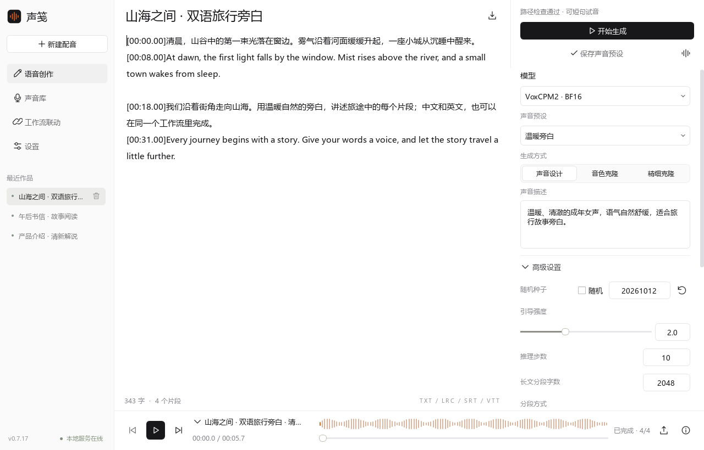
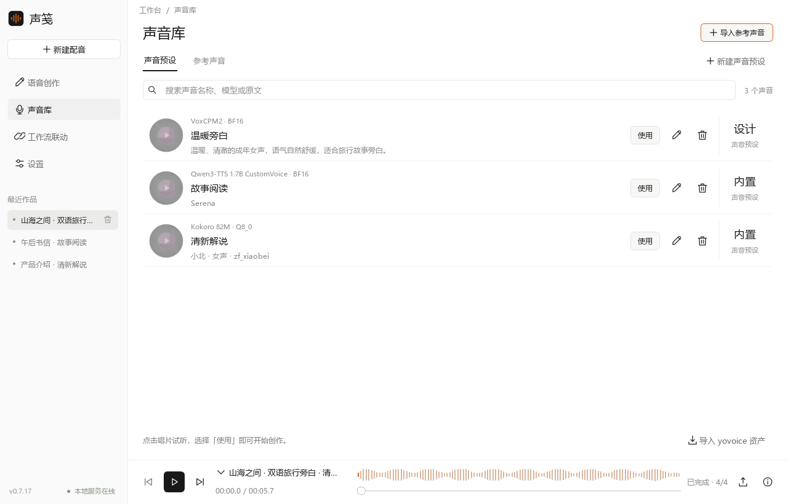
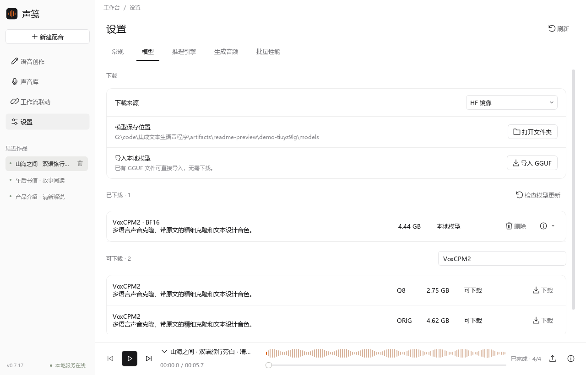
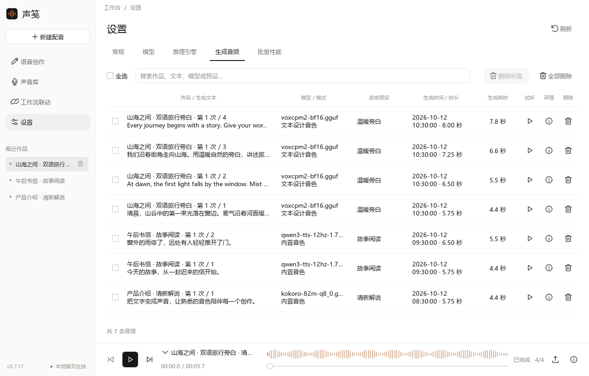
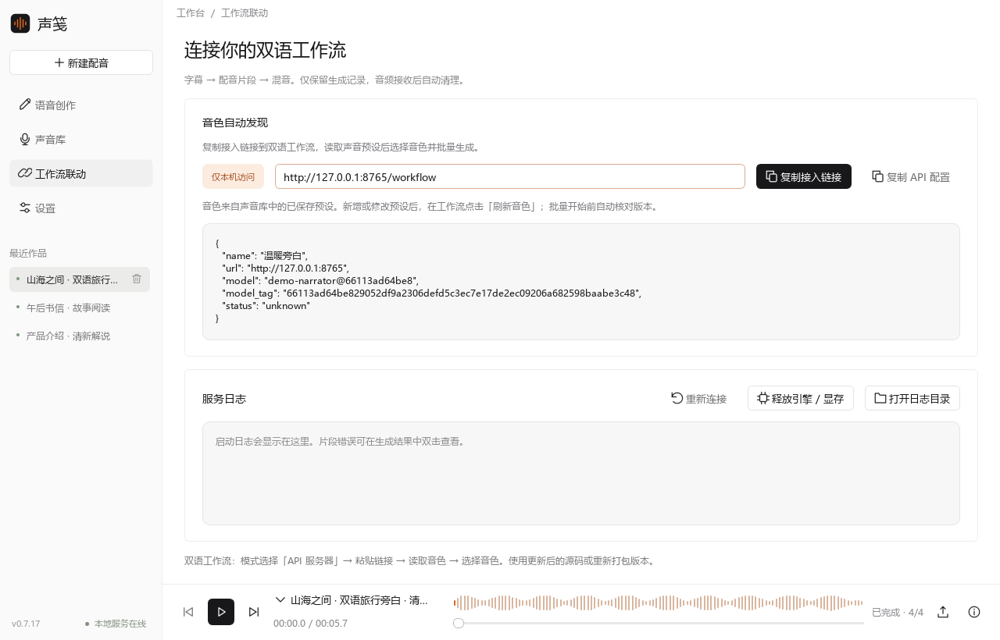
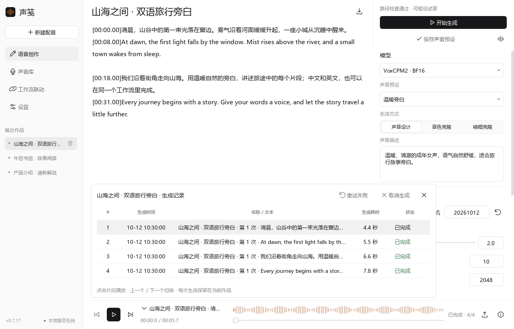
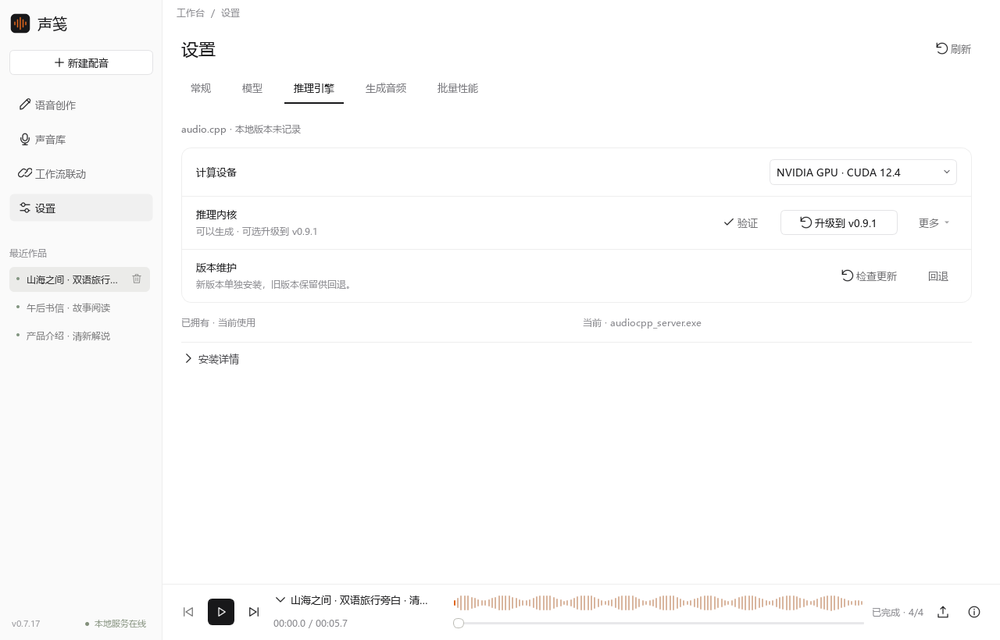
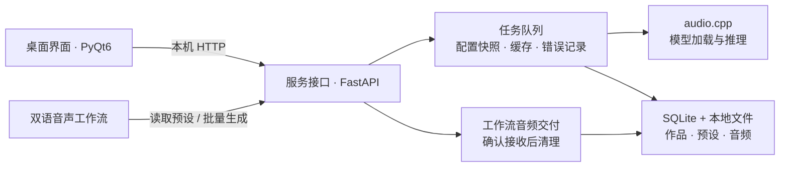

<div align="center">


# 声笺 · Shengjian TTS

**让文字拥有声音，让配音融入你的工作流。**

本地语音生成 · 声音预设 · 双语工作流联动

<p>
  
  
  
</p>

[快速开始](#快速开始) · [界面预览](#界面预览) · [工作流联动](#双语工作流联动) · [代码结构](#代码结构)

[接口说明](API.md) · [UI 风格规范](UI_STYLE.md) · [更新记录](CHANGELOG.md) · [第三方许可](THIRD_PARTY_NOTICES.md)

</div>



<p align="center"><sub>v0.7.17 实际界面 · 截图使用演示文本与数据，生成耗时仅作界面示例。</sub></p>

## 可以做什么

| 功能 | 使用方式 |
| :--- | :--- |
| **语音创作** | 输入文本或导入 TXT / LRC / SRT / VTT，按片段生成，结果追加到当前作品。 |
| **按模型配置** | 根据模型实际能力显示音色、克隆、声音设计和高级参数，支持固定随机种子。 |
| **声音库** | 保存声音预设、导入参考音频；生成音频也可右键加入参考声音。 |
| **音频管理** | 底部播放器切换片段；查看文本、模型、预设与耗时，支持试听和批量删除。 |
| **模型与引擎** | 下载、导入和删除 GGUF，安装并验证推理引擎与运行库。 |
| **工作流接入** | 通过本机链接读取预设，批量配音；工作流记录不挤占侧栏作品列表。 |

## 界面预览

点击图片查看原图。

<table>
  <tr>
    <td width="50%" align="center">
      <a href="docs/images/voice-library.png"></a>
      <br /><b>声音库</b><br /><sub>保存常用音色，复用声音预设</sub>
    </td>
    <td width="50%" align="center">
      <a href="docs/images/models.png"></a>
      <br /><b>模型管理</b><br /><sub>下载、导入与检查模型更新</sub>
    </td>
  </tr>
  <tr>
    <td width="50%" align="center">
      <a href="docs/images/audio-manager.png"></a>
      <br /><b>生成音频管理</b><br /><sub>查看生成记录，试听与批量清理</sub>
    </td>
    <td width="50%" align="center">
      <a href="docs/images/workflow.png"></a>
      <br /><b>双语工作流联动</b><br /><sub>一个本机链接，接入保存好的声音</sub>
    </td>
  </tr>
</table>

<details>
<summary>查看底部播放器与生成列表</summary>



完成后自动试听最新片段；上一个／下一个切换音频，播放与暂停共用一个按钮。

</details>

## 快速开始

**Windows 安装版**：解压程序包，双击 `声笺.exe`。保留同目录的 `声笺服务.exe` 和完整 `_internal/`。

1. **准备模型**：进入「设置 → 模型」，下载或导入兼容 GGUF，安装推理引擎。已有引擎验证通过后显示「已拥有」。
2. **生成声音**：在「语音创作」输入文本，选择模型和生成方式，填写参考声音或声音描述，点击「开始生成」。
3. **保存预设**：保存常用声音，下次创作或双语工作流可以直接选用。导入的参考音频会复制到数据目录。

<details>
<summary>从源码启动（Windows / Python 3.10+）</summary>

```powershell
git clone https://github.com/weizhigao21/shengjian-tts.git
cd shengjian-tts
.\install.bat
.\launch.bat
```

仅运行本机 API 服务：

```powershell
python -m voice_workbench serve --port 8765
```

</details>

### 模型能力

界面读取实际模型包的配置，按能力显示可用功能。统一推理引擎为 [audio.cpp](https://github.com/0xShug0/audio.cpp)，支持 v0.7.4，并可在「设置 → 推理引擎」升级到 v0.9.1。模型需使用兼容包。

| 模型 | 生成方式 |
| :--- | :--- |
| **IndexTTS** | 参考声音克隆、情绪控制 |
| **VoxCPM2** | 声音克隆、精细克隆、声音设计 |
| **Qwen3-TTS** | Base：克隆；CustomVoice：内置音色与风格指令；VoiceDesign：声音设计 |
| **Kokoro** | 模型内置音色 |

高级设置支持固定随机种子，鼠标滚轮只滚动页面。切换到与预设不同的模型或生成方式时，自动转为「无预设」；修改参数后重新保存，工作流才会使用新配置。

## 双语工作流联动

**保存声音预设 → 复制接入链接 → 工作流读取音色 → 批量生成**

在声笺「工作流联动」复制链接，默认地址：

```text
http://127.0.0.1:8765/workflow
```

双语工作流选择「API 服务器」，粘贴链接，点击「读取音色」，选择预设后开始生成。修改预设后刷新音色；生成期间保持声笺服务运行。

工作流只保存数据库生成记录，不创建侧栏作品。音频成功交付到工作流后删除声笺临时副本；整批完成后未接收的音频 1 小时后清理。工作流自己的输出音频保留。

<details>
<summary>旧版工作流适配与批量性能</summary>

给已有双语工作流源码安装适配器，替换路径为你的项目目录；脚本修改前自动备份：

```powershell
python scripts/install_workflow_adapter.py --target "D:\双语音声工作流"
```

安装后重新打包工作流，或从源码启动。新版适配器需要声笺 v0.7.11+；旧 API 调用仍兼容。

「设置 → 批量性能」默认 1 个推理实例，CPU 线程自动分配，工作流并发可设 1–4。每个实例独立加载模型，按实际显存和耗时选择；RTX 2080 Ti 上已测的 VoxCPM2 BF16 双实例比单实例慢。

接口字段、配置版本与交付确认见 [API.md](API.md)。

</details>

<details>
<summary>推理引擎升级与模型更新</summary>



- **引擎**：点击「检查更新」读取官方正式版；新版下载、校验和启动验证通过后，等待当前生成结束再启用。已有 CUDA 12.4 运行库可复用，旧引擎保留，可点击「回退」。检查失败时仍可使用已内置的正式版本。
- **模型**：点击「检查模型更新」，比较固定仓库提交、文件大小和 SHA-256。有更新时单独下载新版，校验模型和预设能力后切换；保留声音预设和旧文件，模型详情菜单提供回退。未匹配下载目录的本地模型继续手动导入。

</details>

## 常用说明

<details>
<summary>作品、生成耗时与参考声音</summary>

- 未命名作品自动使用「创建时间 · 文本开头 5 个字」，可重命名、删除和撤销。
- 两处音频列表都显示生成耗时：包含推理时的模型加载，不含排队；重试显示本次耗时，缓存显示「缓存」，旧记录显示「未记录」。
- 在「设置 → 生成音频」右键选择「添加为参考音频」，自动带入音频与文本。参考音频需为 1–60 秒 WAV，保存独立副本，删除原生成音频后仍可使用。

</details>

<details>
<summary>数据保存、更新与排错</summary>

| 启动方式 | 默认数据目录 |
| :--- | :--- |
| 安装版 | `%LOCALAPPDATA%\声笺\data` |
| 源码版 | 项目 `data/` |
| 指定目录 | 启动时传入 `--data-dir <路径>` |

设置页显示实际目录，可点击「打开本地文件」。数据库为 `tasks.sqlite3`，配置为 `config.json`；音频、参考声音、模型和引擎分别保存在 `audio/`、`voices/`、`models/`、`runtime/`。

更新前退出界面与独立服务并备份数据。替换两个 EXE、完整 `_internal/` 与说明文件，保留用户数据目录。首次从旧文件夹包升级时自动复制原 `data/` 到用户目录，已有用户数据库不会被覆盖。

失败片段显示阶段、原因与建议，修复后可只重试失败片段。错误日志位于 `logs/<任务ID>-<序号>.json`，引擎日志位于 `logs/audio-cpp.log`。默认服务地址为 `127.0.0.1:8765`，同一数据目录只允许一个服务实例。

本地服务启动失败会显示端口或目录访问原因，悬停状态可看详情；在「工作流联动 → 服务日志」点击「重新连接」可重试。端口被限制时，从程序目录正常启动或使用 `--port <可用端口>`，并同步修改双语工作流链接；无需删除数据库或音色。

</details>

<details>
<summary>Windows 一键打包</summary>

```powershell
.\打包.bat --no-pause
```

脚本检查依赖并打包，缺少 pip 时使用 ensurepip 离线补齐。产物为 `dist/声笺/` 和 `dist/声笺-v版本-windows-x64.zip`，包含程序、文档与界面图片，不含个人数据库、音色、音频、模型或引擎。

</details>

## 代码结构

Python / PyQt6 + FastAPI + audio.cpp。界面与服务分进程运行，通过本机 HTTP 通信；任务管理器负责队列、配置快照、缓存与错误记录。



<details>
<summary>展开完整代码目录</summary>

```text
集成文本生语音程序/
├─ voice_workbench/                 主程序
│  ├─ __main__.py                   GUI / 服务命令行入口
│  ├─ __init__.py                   版本号
│  ├─ gui.py                       主窗口、异步 API 请求、作品操作与播放
│  ├─ gui_layout.py                页面布局、侧栏与播放器组件组装
│  ├─ service_status.py            本地服务启动错误的中文诊断
│  ├─ ui.py                        通用组件、浮层、波形、图标与样式
│  ├─ model_controls.py            模型、生成方式、参考声音与运行环境控件
│  ├─ generation_controls.py       根据参数定义构建高级设置控件
│  ├─ library.py                   预设、参考声音列表与编辑弹窗
│  ├─ settings.py                  模型、音频管理与批量性能页面
│  ├─ api.py                       FastAPI 路由、服务生命周期与错误响应
│  ├─ workflow.py                  工作流音色发现、可用状态与配置版本
│  ├─ workflow_audio.py            工作流临时音频、接收确认、到期与历史清理
│  ├─ schemas.py                   请求与声音配置的数据结构、字段校验
│  ├─ manager.py                   任务排队、独立推理实例、恢复与缓存
│  ├─ model_management.py          模型目录、下载续传、校验、导入与删除
│  ├─ engine_management.py         统一推理引擎下载、解压、安装与切换
│  ├─ engine_updates.py            官方正式版、Windows 下载包与摘要检查
│  ├─ model_updates.py             固定模型提交、文件大小与 SHA-256 发现
│  ├─ engine_validation.py         Windows x64 文件头、计算后端与 DLL 依赖验证
│  ├─ downloads.py                 模型和引擎共用的续传与文件校验
│  ├─ audio_cpp.py                 统一后端选择、原生引擎进程与请求适配
│  ├─ native_paths.py              中文模型路径兼容、临时硬链接及清理
│  ├─ runner.py                    配置和 WAV 校验、Python 推理进程管理
│  ├─ engine_worker.py             Python 推理子进程入口
│  ├─ model_info.py                读取 GGUF / 引擎声明的模型能力
│  ├─ generation_options.py        高级参数定义、范围与值校验
│  ├─ config.py                    配置持久化、声音预设与参考声音管理
│  ├─ runtime.py                   源码 / EXE 路径、后台入口与外部 DLL 环境
│  ├─ data_paths.py                固定用户数据目录、旧数据库迁移与内部路径修复
│  ├─ discovery.py                 发现已有 yovoice 引擎、模型与参考资产
│  ├─ store.py                     SQLite 作品、片段、历史快照与缓存记录
│  ├─ naming.py                    未命名作品自动命名
│  ├─ subtitles.py                 文本与 TXT / LRC / SRT / VTT 解析
│  ├─ errors.py                    错误代码、阶段、原因与恢复建议
│  └─ assets/                      程序图标、模型及引擎下载目录、来源许可
├─ integration/                    双语工作流适配器、配置及安装备份
│  ├─ local_voice_client.py        音色发现、版本固定、批次下载与保存后确认
│  └─ local_voice_picker.py        工作流中的链接接入、音色选择与刷新控件
├─ scripts/                        联动安装、快捷方式、图标与验证脚本
│  ├─ build_package.py             打包、产物验证、旧包备份与数据延续
│  ├─ frozen_entry.py              界面 EXE 与后台服务 EXE 的共同入口
│  ├─ check_engine_download.py     真实引擎下载、暂停续传、安装与推理检查
│  ├─ render_readme.py             隔离演示数据，渲染 README 界面截图
│  └─ check_packaged_app.py        发布包启动、引擎安装、真实配音与退出检查
├─ docs/images/                    README 项目图标与界面截图
├─ tests/                          服务、模型、任务、界面与资产管理测试
├─ data/                           源码默认数据；安装版使用用户目录下的同结构
│  ├─ config.json                  模型路径、声音预设与参考声音配置
│  ├─ tasks.sqlite3                作品、生成片段、快照与缓存索引
│  ├─ audio/                       生成的 WAV 文件
│  ├─ workflow-audio/              工作流临时 WAV，接收确认后删除
│  ├─ models/                      下载模型及未完成的下载文件
│  ├─ runtime/                     下载的统一引擎、运行库及未完成的安装包
│  ├─ voices/                      导入或复制的参考音频
│  ├─ logs/                        片段错误与推理引擎日志
│  └─ temporary/                   运行时临时文件
├─ artifacts/                      验证输出与界面预览
├─ launch.bat                      Windows 启动脚本
├─ install.bat                     环境依赖安装脚本
├─ 打包.bat                        Windows 一键打包脚本
├─ 声笺.spec                       图标、资源、依赖与双 EXE 打包配置
├─ pyproject.toml                  Python 打包、依赖与测试配置
├─ README.md                       使用说明与代码结构
├─ API.md                          本机接口与工作流音频交付说明
├─ UI_STYLE.md                     可供其他程序复用的 UI 风格规范
├─ CHANGELOG.md                    版本更新记录
└─ THIRD_PARTY_NOTICES.md           第三方来源与许可说明
```

</details>

| 要修改什么 | 从这里开始 |
| :--- | :--- |
| 布局与组件 | `gui_layout.py`、`ui.py`；跨程序复用参考 [UI_STYLE.md](UI_STYLE.md) |
| 模型与高级参数 | `model_info.py`、`generation_options.py`、后端适配 |
| 任务与数据 | `manager.py`、`store.py` |
| 工作流与接口 | `api.py`、`integration/`；字段说明见 [API.md](API.md) |

<details>
<summary>开发验证与截图更新</summary>

```powershell
python -m pip install -e ".[test]"
python -m pytest -q
python scripts/check_packaged_app.py
python scripts/check_advanced_generation.py
```

实际推理检查需要对应模型、引擎与正常 Windows 用户权限。

使用已配置的 VoxCPM2、Qwen3 CustomVoice、Kokoro 模型刷新演示截图：

```powershell
python scripts/render_readme.py
```

脚本在临时目录构建演示数据，不执行推理；读取模型元信息，不修改用户配置，不导出个人文本或音频。

</details>
