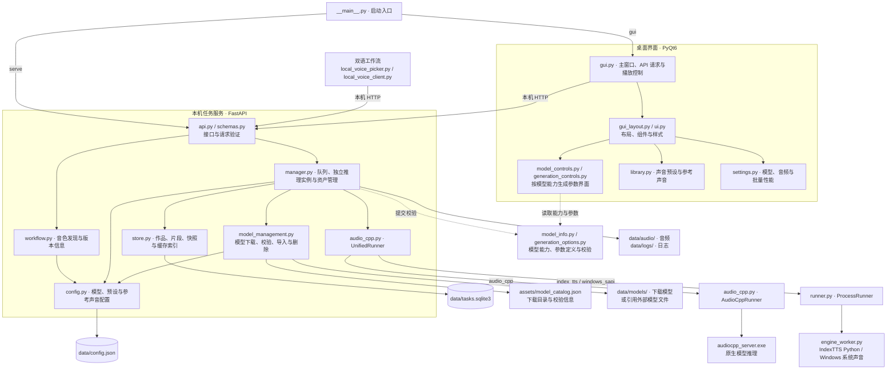

# 声笺 · 本地配音工作台

当前版本 **v0.7.0**（2026-10-12）。[更新记录](CHANGELOG.md)

Python / PyQt6 管理界面 + FastAPI 任务服务 + audio.cpp 统一推理引擎。  
用于现有「双语音声工作流」的语音生成步骤，保留字幕提取与混音流程。

## 启动

在 Windows 上安装 **64 位 Python 3.10+**，下载或克隆本仓库，运行 **install.bat** 安装依赖，完成后双击 **launch.bat** 启动。模型推理不依赖 GUI 环境的 PyTorch；模型权重和统一引擎需在设置中单独配置。

```powershell
git clone https://github.com/weizhigao21/shengjian-tts.git
cd shengjian-tts
.\install.bat
.\launch.bat
```

已有运行环境也可使用下面的命令。带图标的 **声笺.lnk** 快捷方式通过后文的脚本在本机创建，不随源码分发。

```powershell
python -m voice_workbench gui
# 或只运行服务
python -m voice_workbench serve --port 8765
# 查看版本
python -m voice_workbench --version
```

更新后关闭旧窗口，再重新启动；独立运行的旧服务也需重启。任务、声音预设和缓存保存在 `data/`，升级时保留该目录。

程序标题栏和侧栏显示当前版本，窗口与任务栏使用统一的声波图标。项目移动到其他目录后，可重新创建启动快捷方式：

```powershell
powershell -ExecutionPolicy Bypass -File .\scripts\create_shortcut.ps1
```

图标源文件为 `voice_workbench/assets/app.svg`；Windows 多尺寸图标为 `app.ico`，修改 SVG 后运行 `python scripts/build_icon.py` 重新生成。

默认服务仅监听 `127.0.0.1:8765`，数据保存于项目 `data/`。  
使用 `--data-dir <路径>` 可切换独立数据目录，同一目录只允许一个服务实例。  
关闭由界面启动的服务时，已完成片段保留，中断的片段下次启动自动排队；失败片段需要手动重试。  
单独运行的服务可供界面连接；此时关闭界面不会停止服务。

## Windows 打包

在 Windows 上使用 **64 位 Python 3.10+**，双击项目根目录的 **打包.bat**。脚本优先使用 `.venv`，其次尝试 `py -3.10`、`py -3` 和 `python`，自动检查并安装缺失的运行依赖和 PyInstaller，再执行 `声笺.spec`。

产物位于 **`dist/声笺/`**：双击 **声笺.exe** 启动界面，**声笺服务.exe** 供界面在后台启动 API 和 Windows 系统声音工作进程；两个 EXE 和 `_internal/` 必须一起保留。图标、界面资源、模型下载目录信息及说明文件已包含，使用界面和统一引擎配音无需安装 Python。

分发时压缩整个 `dist/声笺/` 文件夹；若该发布目录已经使用过，先移出其中的个人 `data/`，接收者首次启动会自动创建自己的数据目录。GGUF 模型权重、`audiocpp_server.exe` 及其配套 DLL、备用 IndexTTS 的 Python 环境不包含在新包中；在模型管理或生成配置中指定对应路径。打包不复制源码项目中的 `data/`、参考音频或历史生成音频。

发布包默认在 **EXE 同级 `data/`** 保存任务、预设、模型下载和日志。再次打包前关闭旧发布程序；脚本将旧程序保留为 `dist/声笺-backup-时间/`，把已有发布目录中的 `data/` 延续到新包，不重复复制大模型。旧程序备份只包含程序文件，数据仍在当前发布目录。发布替换失败时会尝试恢复原目录；打包失败的完整日志在命令窗口中显示。

自动化执行可用 `打包.bat --no-pause`，不会暂停或打开资源管理器。仅运行打包步骤也可执行 `python scripts/build_package.py`。打包配置与资源路径遵循 [PyInstaller 运行时说明](https://pyinstaller.org/en/stable/runtime-information.html)。

开发者可运行 `python scripts/check_packaged_app.py` 验证发布包：测试数据写入独立 `artifacts/package-check/` 目录，检查 EXE 自动启动服务、音色发现、模型目录、Windows 系统声音、已有 Kokoro 模型、双实例批量生成与任务合并，以及关闭后的服务退出。测试 Windows 系统声音需要正常 Windows 用户权限；受限沙箱可能无法访问语音注册表。

## 桌面界面

界面参考 yovoice 的紧凑工作台，采用白底、细分隔线、侧栏导航、中央编辑区、右侧声音栏和底部试听栏。生成记录收在播放器名称的展开列表里，中央只保留文本编辑区；底部不再保留常驻状态栏，操作提示短暂浮现。

- **语音创作**：导入字幕或文本，在右栏选择模型与声音预设，直接配置生成方式、参考声音、语言、音色、语速和描述。左侧保留最近作品；点击「新建配音」创建作品，后续生成和短句试音都追加到当前作品。首次直接生成会自动创建当前作品。
- **声音库**：以紧凑列表展示预设；支持搜索、试听、使用、编辑和删除。「参考声音」可以独立导入 WAV、编辑名称与原文，日常操作无需填写引擎路径表单。
- **工作流联动**：复制音色自动发现的接入链接，让双语工作流直接读取已保存的声音预设；也可复制单个预设的 API 配置，查看服务日志或释放显存。
- **设置**：包含「模型管理」「生成音频管理」「批量性能」。模型管理整页统一上下滚动，可查看功能说明、下载、暂停续传、导入或删除；音频可试听、查看生成时信息，并逐条、多选或全部删除；批量性能可调整工作流并发和 CPU 线程。
- 首个完成片段自动选中，显示实际 WAV 波形；底部支持上一个、下一个、播放／暂停切换和拖动进度。切换时跳过未完成、失败和文件不存在的片段，播放结束后继续下一个。
- 点击播放器名称向上展开生成列表，查看名称、文本、生成次数、生成时间和状态；字幕原始时间保留在提示及导出文件中。列表内可重试、取消、双击失败片段查看完整错误；播放器导出按钮按选中的生成批次导出，避免将不同尝试混入同一时间轴。
- 最近作品支持右键打开、重命名和删除；悬停时也可直接点击垃圾桶。删除运行中的作品会先取消生成，浮动提示提供 10 秒撤销入口。
- 草稿标题与文本自动保存，重新打开作品恢复当前草稿；生成历史独立保留，重复生成不会将历史文本重复填回编辑器。
- 未命名作品有文本后自动命名为「创建时间 · 文本开头 5 个字」，字幕时间戳不参与命名。自动名称随草稿文本更新，手动填写名称后会固定。
- 启动时先只读加载已有作品，服务连接后同步状态，无需点击新建触发刷新。播放器名称单击展开、再单击收起，也可点击外部或按 Esc；定时同步只更新变化的单元格，保留选择、滚动位置和焦点。
- 任务与声音采用可恢复删除，保留缓存音频、参考文件和任务配置，避免破坏其他任务共享的音频。删除最后一个声音预设也保留模型选择入口。

声音库支持「声音预设 / 参考声音」切换：预设的「使用」直接带入生成页；参考声音只需导入音频、填写名称及可选原文。编辑预设时，弹窗随模型能力显示所需参数，例如 Kokoro 仅显示内置音色及其支持的语言、语速。

生成页「高级设置」展示所选模型的生成参数；「模型与运行环境」另行折叠，调整设备、超时、模型文件、引擎或备用 Python 环境路径。更换 GGUF 会重新读取模型能力并识别家族。窗口最小尺寸为 1080×720。

| 模型 | 高级生成参数 |
| --- | --- |
| VoxCPM2 | 引导强度、推理步数、分段字数与方式、最大/最小生成长度、连续/独立生成策略、异常重试次数与比例阈值、随机种子 |
| IndexTTS（audio.cpp） | 采样温度、Top P / Top K、重复惩罚、最大生成长度、段间静音、搜索束数、长度惩罚、分段方式、随机种子 |
| Qwen3-TTS | 采样、温度、Top P / Top K、重复惩罚、解码器采样、长文分段与随机种子，具体按模型包声明显示 |
| Kokoro | 模型包支持的分段字数与随机种子 |

参数优先读取模型包或所选引擎的声明；旧包缺少参数定义时使用已经核对 audio.cpp v0.7.4 源码的适配定义。不同模型切换后会刷新参数及范围，不把 VoxCPM2 的参数带入 Kokoro。

生成长度表示音频 token 上限，不是文字字数。分段字数允许设为 0 时表示采用模型默认值；分段发生在每条字幕/文本内部，保留任务的时间戳。随机种子为「随机」时每次生成记录实际种子，重试沿用该种子，再次生成产生新的声音样本。每批生成的模型和参数独立保存；更换当前模型或声音，不会覆盖历史片段的配置。无效范围在提交前提示具体参数。

界面读取 GGUF 内嵌模型配置和 `voices.json`；旧模型缺少能力声明时，读取所选引擎的 `model_specs`。
模型提供的能力还须有对应请求适配，才会显示为可用选项。

- Kokoro：按语言选择模型包实际包含的内置音色；提供语速参数的包才显示语速，不显示参考音频、声音克隆、音色设计或情绪描述。
- IndexTTS：参考声音克隆与情绪控制；语言、语速按适配版本显示。
- VoxCPM2：按配置显示克隆、带原文的精细克隆、文本设计；自动识别语言。
- Qwen3-TTS：按模型包的 Base / CustomVoice / VoiceDesign 变体显示对应方式。

创作页面右栏可以上传或选择已有参考音频并试听，填写参考原文，直接生成；参数随任务保存，定时刷新不会重置它们。
无需先保存即可试音与生成。「保存声音预设」会保存当前模型和参数，参考音频复制到本项目声音库，并选中新预设、复制其版本化联动配置，可直接粘贴到双语工作流。原预设保留。

## 模型与生成音频管理

左下角打开「设置」。模型管理展示已添加的模型和可下载目录，使用 yovoice 的语音模型目录、固定版本地址及 SHA-256 校验信息。目前支持 IndexTTS、VoxCPM2、Kokoro 和 Qwen3-TTS 的 22 个条目，其中两个 Kokoro 历史版本仅支持导入本地文件。每个条目说明可用功能；Q8、BF16 等版本的实际大小直接显示在列表中。

模型管理使用一个整体滚动区域：搜索与下载源、已添加模型、下载目录和底部说明一起上下移动，设置标题和管理页签保持可见。鼠标放在模型行、操作按钮或表头上都能用滚轮滚动整页，也可拖动右侧滚动条。两个模型列表不再独立滚动；下载进度刷新保留当前位置，搜索结果减少后页面自动收缩。页面沿用白底与细分隔线。

下载源可选 HF 镜像、Hugging Face 或 ModelScope。同一时间下载一个模型，列表显示进度和具体失败原因，支持暂停、续传和重试；退出程序保留未完成文件。下载模型位于 `data/models/`，大小与 SHA-256 校验成功后自动加入创作页，不需要先建立声音预设。缺少引擎时，点击「推理引擎」选择已有的 `audiocpp_server.exe`；本机已有引擎会自动复用。导入 GGUF 时从文件配置识别家族和能力。

删除模型的弹窗显示真实路径与关联预设数量，可选择只移出程序或同时删除文件。程序下载的模型默认勾选删除文件，外部模型默认保留文件。仅对明确选中的 GGUF 文件执行文件删除，不递归删除模型目录。正在使用或排队使用的模型需要先完成或取消任务。模型删除会移除对应声音预设；参考声音和已经生成的音频保留。

生成音频管理以列表显示作品、生成次数、文本、模型、模式、预设、生成时间和时长。每行可试听、查看完整文本与当时的配置、删除音频；右上角提供「删除所选」「全部删除」，复选框支持多选和筛选后的全选。全选只选择当前搜索结果，全部删除针对确认时整库已有的音频；确认期间新完成的音频会保留。

新的生成记录保存预设名称和是否调整过参数，之后重命名或修改预设不会改变历史信息。没有来源记录的旧音频显示「旧记录 · 来源未记录」，不推测其预设来源。已从最近作品移除的作品仍保留音频，可在管理列表清理。

删除生成音频会移除对应播放器记录；只有最后一条引用被删除时才删除共用的 WAV 文件并清除缓存。删除不会清空作品文本或删除作品。文件被其他程序占用时显示具体原因并保留该记录，便于重试。模型文件删除及音频删除均需确认，不能撤销；作品、声音库原有的撤销行为保持不变。

## 统一引擎与已有模型

主后端直接启动 `audiocpp_server.exe`，并调用 `/v1/tasks/run`；同一模型的连续片段复用模型进程。  
普通创作按片段串行生成。双语工作流可配置 1–4 个独立推理实例，各自复用模型进程；切换模型时关闭该实例的旧引擎。空闲 2 分钟后由引擎释放模型。  
「释放推理引擎 / 显存」按钮可以立即停止空闲引擎。

首次运行会读取本机 `~/.yovoice/state.json` 中已安装的 CUDA 引擎、IndexTTS、VoxCPM2 和 Kokoro 模型位置，并把参考音频复制到本项目的声音库。  
也可以在「声音库」底部点击导入。只读取旧项目的资产位置，不沿用其任务状态、草稿或错误配置。
**模型与引擎仍引用原文件，删除它们后需重新指定路径。**

- 当前主要验证模型：IndexTTS 2.5 Q8，RTX 2080 Ti。
- 参考音频要求：1–60 秒、可读取的 PCM WAV；含中文路径的参考音频会临时转存至 ASCII 路径供原生引擎读取。
- VoxCPM2、Kokoro、Qwen3-TTS 提供对应请求适配；是否可用取决于引擎版本、模型包和附加资源，必须短句试生成确认。
- Windows 系统声音是基础联动测试后端；不是 AI 声音克隆，不能替代模型效果。
- 官方 IndexTTS Python 环境仅为备用选项，独立指定 Python、源码和模型目录，不默认安装 PyTorch 或下载模型。

GGUF 只是容器格式，须使用 **audio.cpp 支持的对应模型包**。任意其他软件的 GGUF 不保证兼容。  
依赖与模型能力参考 [audio.cpp](https://github.com/0xShug0/audio.cpp)、[yovoice](https://github.com/leemysw/yovoice)。

## 生成和故障恢复

1. 选择声音，执行「短句试生成 / 预热」。
2. 输入每行一句的文本，或导入 TXT / LRC / SRT / VTT。
3. 开始生成；生成记录追加到当前作品，进度显示在播放器。修改文本或参数后可再次生成，历史记录保留。
4. 点击播放器名称展开列表，选择片段试听；双击失败片段查看阶段、原因、建议、原始异常。
5. 修复后只重试失败 / 取消片段。成功片段保留，不重新生成。

模型、参考音频、语言、语速、情绪和版本参与缓存标识。复用缓存前检查 WAV 与文件校验值；损坏缓存会重新生成。  
每条片段保存提交时的声音配置快照，修改预设后可在同一作品内追加生成；旧片段的模型或参考文件变化时会明确提示。旧数据库自动补齐历史快照，保留原任务、音频和缓存。  
错误片段日志在 `data/logs/<任务ID>-<序号>.json`，统一引擎日志在 `data/logs/audio-cpp.log`。

## 接入双语音声工作流

推荐使用音色自动发现，只需添加一次链接；音色选择在双语工作流中完成。

1. 启动声笺，在「声音库」保存需要使用的声音预设。克隆声音的参考音频、设计声音的描述、内置音色和高级参数均随预设保存。
2. 打开声笺「工作流联动」，点击「复制接入链接」。默认链接为 `http://127.0.0.1:8765/workflow`；使用其他端口时复制界面显示的实际链接。
3. 双语工作流的 TTS 模式选择「API 服务器」，在「声笺链接」中粘贴链接，点击「读取音色」。程序添加一个声笺服务入口，保留已有其他 API 配置。
4. 在「音色」下拉框选择预设。提示和悬停信息显示模型、生成方式、语言及内置音色；不可用项禁用并说明原因。
5. 按需要设置「使用批量API」及批量大小，再执行语音生成。工作流通过异步任务接口提交片段，等待结果并下载到原有输出目录，后续混音流程继续使用这些音频。

新增预设后点击「刷新音色」；重新打开已连接的 API 参数页也会自动读取。批量开始前再次读取所选音色的配置版本，同步保存工作流中的版本信息，再计算输出目录和缓存标识，预设参数更新后无需手工填写模型名称或标签。一次任务使用固定的版本；生成途中预设发生变化会明确报错，避免混用音色和旧缓存。删除或损坏的已选音色要求重新选择或修复，不自动替换为其他声音。

发现列表只展示已保存的声音预设，不将尚未配置参考音频或描述的模型模板当作可用音色。服务仅供本机工作流使用；连接和生成期间保持声笺服务运行。

本项目兼容旧 `/infer_single`、`/infer_bulk` 及 `audio_url` / `audio_urls` 返回形式。  
更新工作流源码中的异步适配器和音色选择界面：

```powershell
python scripts/install_workflow_adapter.py --target "G:\code\双语音声工作流"
```

脚本精确匹配源码，修改前在本项目 `integration/backups/` 备份；预期不匹配时不写文件。  
修改涉及 `tts_utils.py`、`tts_worker.py`、`step2_tts.py` 和 `widgets/tts_panel.py`，安装 `steps/local_voice_client.py` 与 `widgets/local_voice_picker.py`。  
适配器只针对声明 `async_jobs` 的本机配音服务启用；原有其他 API 继续使用原协议。  
已打包的旧 EXE 不包含这些源码修改，需重新打包；也可以先从源码运行工作流。

手动接入旧界面时，工作流 TTS 配置选择 **API**，在服务器列表添加：

- URL：`http://127.0.0.1:8765`
- 模型：从本工作台「工作流联动」复制版本化模型名称。
- 模型标签：复制对应标签；声音配置变化后同步更新，避免旧缓存被误用。

同一项工作流配音运行的多个小批次追加到一个声笺任务中，名称为「双语配音 · 源文件名」；下一轮重新执行创建新的任务。全部命中工作流缓存时不创建服务任务。多 API 同时提交给同一声笺服务也会合并，返回各自的批次编号和片段位置，不会拿到上一批的音频。部分失败时成功片段会下载并保留；停止工作流只取消其已提交批次。旧历史任务不会自动删除。  
此功能要求声笺 **v0.7.0+** 和更新后的工作流适配器。适配器检测到旧服务会提示升级并停止提交，避免继续大量创建任务。旧 `/infer_single`、`/infer_bulk` 保留独立任务行为。  
暂停工作流只影响其后续派发，已经提交的服务任务继续生成。  
Whisper 与语音模型共用 GPU 时，建议先用工作流「按步骤」模式；跨程序的 GPU 排他调度尚未实现。

### 批量推理性能

在声笺 **设置 → 批量性能** 调整「批量并发数」和「每个实例的 CPU 线程数」，点击「应用设置」。并发仅用于通过新适配器提交的工作流统一引擎任务；Windows 系统声音和备用 Python 后端保持串行。调整前完成或取消正在生成的音频。

默认 **1 个实例，CPU 线程自动分配**。CPU 线程为 0 时，按逻辑核心数和并发数分配，每个实例最多 8 线程；显式值可设为 1–128。工作流「批量大小」控制每次提交多少条字幕，并发数控制服务同时推理多少条；要测试 2 个实例，批量大小也需至少为 2，单纯增加工作流线程不能提高串行引擎的吞吐。

本机 audio.cpp v0.7.4 会锁住单个模型的推理请求，因此并发采用独立引擎进程，各自加载模型和执行缓存；不会将多个线程直接访问同一个模型会话。大模型并发需要额外内存和显存，遇到显存不足时，当前任务自动降为单实例，相关失败片段沿用原始参数重试一次；再次失败保留具体错误和日志。释放引擎、取消作品和退出服务会处理全部实例，额外实例日志位于 `data/workers/<编号>/logs/`。

2026-10-12 的一次本机短文本测试（RTX 2080 Ti、VoxCPM2 BF16、同样 4 段、固定种子、每实例 4 CPU 线程、排除启动及短句预热）：单实例 **12.015 秒**，双实例 **24.906 秒**；双实例运行后整卡显存约 **10.1 GiB**，单实例约 **6.1 GiB**。另外单实例 1 / 8 CPU 线程约 10.516 / 10.343 秒。这些结果说明当前模型增加并发没有提速，默认保持单实例；其他模型应比较实际生成时间再调整，不以 CPU / GPU 占用百分比作为速度结论。报告保存在 `artifacts/batch-performance/`。

## 代码结构

桌面界面与任务服务分进程运行，通过本机 HTTP 通信。双语工作流接入同一服务；任务管理器统一处理排队、配置快照、缓存、错误记录和音频管理，再调用所选推理后端。



目录与主要文件职责如下。图中的 `audiocpp_server.exe` 是外部推理程序，由配置指定路径。

```text
集成文本生语音程序/
├─ voice_workbench/                 主程序
│  ├─ __main__.py                   GUI / 服务命令行入口
│  ├─ __init__.py                   版本号
│  ├─ gui.py                       主窗口、异步 API 请求、作品操作与播放
│  ├─ gui_layout.py                页面布局、侧栏与播放器组件组装
│  ├─ ui.py                        通用组件、浮层、波形、图标与样式
│  ├─ model_controls.py            模型、生成方式、参考声音与运行环境控件
│  ├─ generation_controls.py       根据参数定义构建高级设置控件
│  ├─ library.py                   预设、参考声音列表与编辑弹窗
│  ├─ settings.py                  模型、音频管理与批量性能页面
│  ├─ api.py                       FastAPI 路由、服务生命周期与错误响应
│  ├─ workflow.py                  工作流音色发现、可用状态与配置版本
│  ├─ schemas.py                   请求与声音配置的数据结构、字段校验
│  ├─ manager.py                   任务排队、独立推理实例、恢复与缓存
│  ├─ model_management.py          模型目录、下载续传、校验、导入与删除
│  ├─ audio_cpp.py                 统一后端选择、原生引擎进程与请求适配
│  ├─ runner.py                    配置和 WAV 校验、Python 推理进程管理
│  ├─ engine_worker.py             Python 推理子进程入口
│  ├─ model_info.py                读取 GGUF / 引擎声明的模型能力
│  ├─ generation_options.py        高级参数定义、范围与值校验
│  ├─ config.py                    配置持久化、声音预设与参考声音管理
│  ├─ runtime.py                   源码 / EXE 路径、后台入口与外部 DLL 环境
│  ├─ discovery.py                 发现已有 yovoice 引擎、模型与参考资产
│  ├─ store.py                     SQLite 作品、片段、历史快照与缓存记录
│  ├─ naming.py                    未命名作品自动命名
│  ├─ subtitles.py                 文本与 TXT / LRC / SRT / VTT 解析
│  ├─ errors.py                    错误代码、阶段、原因与恢复建议
│  └─ assets/                      程序图标、模型目录与来源许可
├─ integration/                    双语工作流适配器、配置及安装备份
│  ├─ local_voice_client.py        音色发现、版本固定、任务合并与批次下载
│  └─ local_voice_picker.py        工作流中的链接接入、音色选择与刷新控件
├─ scripts/                        联动安装、快捷方式、图标与验证脚本
│  ├─ build_package.py             打包、产物验证、旧包备份与数据延续
│  ├─ frozen_entry.py              界面 EXE 与后台服务 EXE 的共同入口
│  └─ check_packaged_app.py         发布包启动、真实配音与服务退出检查
├─ tests/                          服务、模型、任务、界面与资产管理测试
├─ data/                           默认运行数据；升级时保留
│  ├─ config.json                  模型路径、声音预设与参考声音配置
│  ├─ tasks.sqlite3                作品、生成片段、快照与缓存索引
│  ├─ audio/                       生成的 WAV 文件
│  ├─ models/                      下载模型及未完成的下载文件
│  ├─ voices/                      导入或复制的参考音频
│  ├─ logs/                        片段错误与推理引擎日志
│  └─ temporary/                   运行时临时文件
├─ artifacts/                      验证输出与界面预览
├─ launch.bat                      Windows 启动脚本
├─ install.bat                     环境依赖安装脚本
├─ 打包.bat                        Windows 一键打包脚本
├─ 声笺.spec                       图标、资源、依赖与双 EXE 打包配置
├─ pyproject.toml                  Python 打包、依赖与测试配置
├─ README.md                       使用说明与代码结构
├─ CHANGELOG.md                    版本更新记录
└─ THIRD_PARTY_NOTICES.md           第三方来源与许可说明
```

修改页面布局主要查看 `gui_layout.py` 和 `ui.py`；修改管理页查看 `settings.py`。扩展模型能力需要同时检查 `model_info.py`、`generation_options.py` 和对应后端的请求适配。任务行为由 `manager.py` 与 `store.py` 实现，工作流接口从 `api.py` 与 `integration/local_voice_client.py` 入手。

## 接口与验证

- `GET /health`：服务身份、队列、当前片段。
- `GET /workflow`：接入信息、已保存音色、模型与模式、可用状态、配置版本；`voice_discovery` 能力表示支持此接口。
- `GET /voices`、`PUT /voices/{id}`：声音预设及版本化模型名称。
- `DELETE /voices/{id}`、`POST /voices/{id}/restore`：移除、恢复预设；已创建任务使用自身配置快照。
- `GET /references`、`POST /references`、`PATCH /references/{id}`：独立参考声音库。
- `DELETE /references/{id}`、`POST /references/{id}/restore`：移除、恢复参考声音。
- `POST /jobs`：异步提交（202）；可选 `workflow_key` 将同一次运行的小批次合并到一个任务。返回 `job_id`、`generation`、`segment_indices` 和仅查询该批次的 `status_url`；不提供键时创建独立任务。
- `POST /jobs/draft`：创建空白作品（201）；`PATCH /jobs/{id}/document` 保存标题与草稿。
- `POST /jobs/{id}/generate`：按同一提交格式，在作品内追加生成批次（202）；片段带 `generation`、`created`、`batch_title` 及独立 `voice` / `fingerprint` 快照。
- `GET /jobs/{id}`：片段进度、音频 URL、具体错误；可带 `?generation=<编号>` 只查询某批次，其状态独立于其他批次的失败或排队。
- `DELETE /jobs/{id}`、`POST /jobs/{id}/restore`、`PATCH /jobs/{id}`：删除、恢复、重命名任务。
- `POST /jobs/{id}/retry`、`POST /jobs/{id}/cancel`：恢复与取消。
- `POST /jobs/{id}/generations/{generation}/cancel`：只取消指定批次。
- `GET /settings/performance`、`PUT /settings/performance`：读取和保存 `workflow_workers`、`cpu_threads`；生成中拒绝更改。
- `POST /engine/release`：释放空闲引擎。
- `GET /audio/{filename}`、`GET /logs/{id}/{index}`：音频及错误详情。
- `GET /models`：已添加模型、可下载目录、下载状态与推理引擎位置。
- `POST /models/import`、`PUT /models/runtime`：导入本地模型、设置共享推理引擎路径。
- `POST /models/{model_id}/download`、`POST /models/{model_id}/pause`：开始或继续模型下载、暂停下载。
- `POST /models/{model_id}/remove`：移出模型，可选择同时删除模型文件。
- `GET /generated-audio`：生成音频列表及文本、模型、模式、预设来源、时间和时长。
- `POST /generated-audio/delete`：按音频 ID 批量删除，或删除当前全部音频；界面提交确认时的 ID 列表以保留之后新完成的音频。

```powershell
python -m pytest -q
python scripts/check_work_generations.py
python scripts/check_generation.py --voice index-2.5-q8-voice1
# 已安装 VoxCPM2 的真实高级参数验证（数据写入 artifacts）
python scripts/check_advanced_generation.py
# 在准备后的工作流界面中读取链接、选择音色并实际批量生成（独立数据目录）
python scripts/check_voice_discovery.py
# 独立数据目录内比较单实例、双实例的实际耗时；不使用生成缓存
python scripts/check_batch_performance.py --family voxcpm2 --workers 1,2 --cpu-threads 4
```

模型接口能力不代表已经测过所有模型。首次加载耗时与连续生成耗时应分别测量；本项目不会把某个模型的速度宣称为其他模型或硬件的速度。
