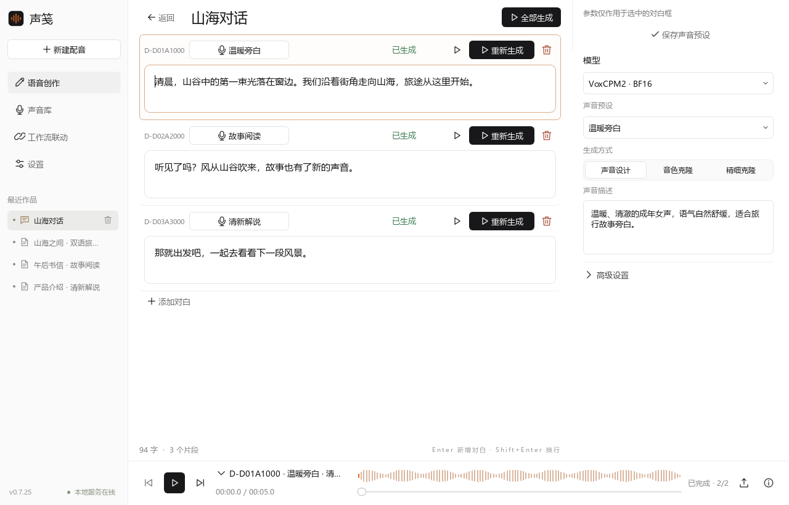
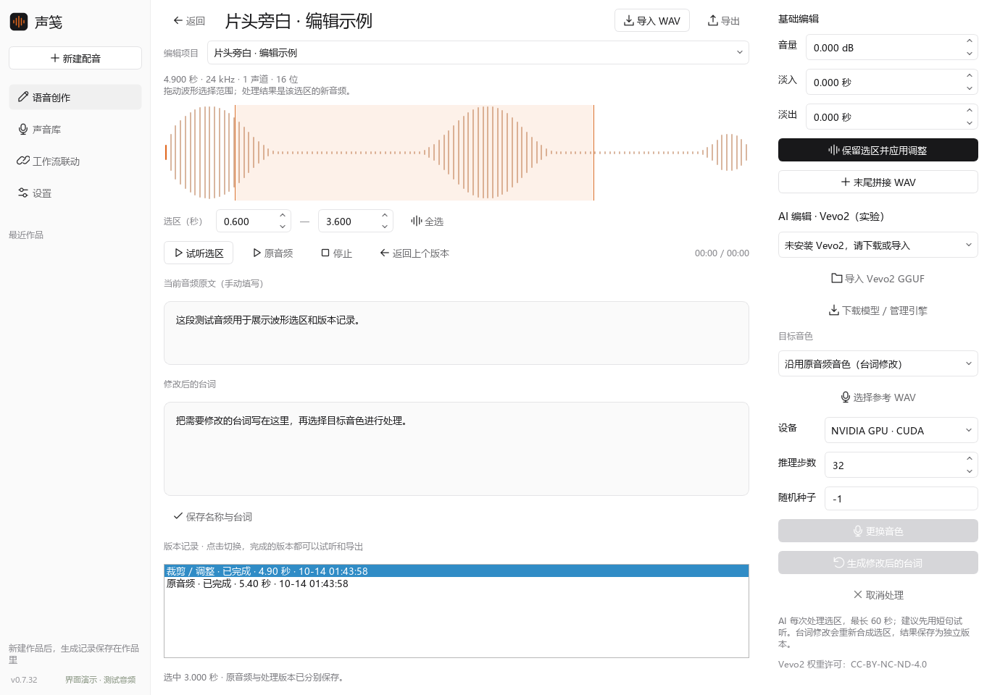
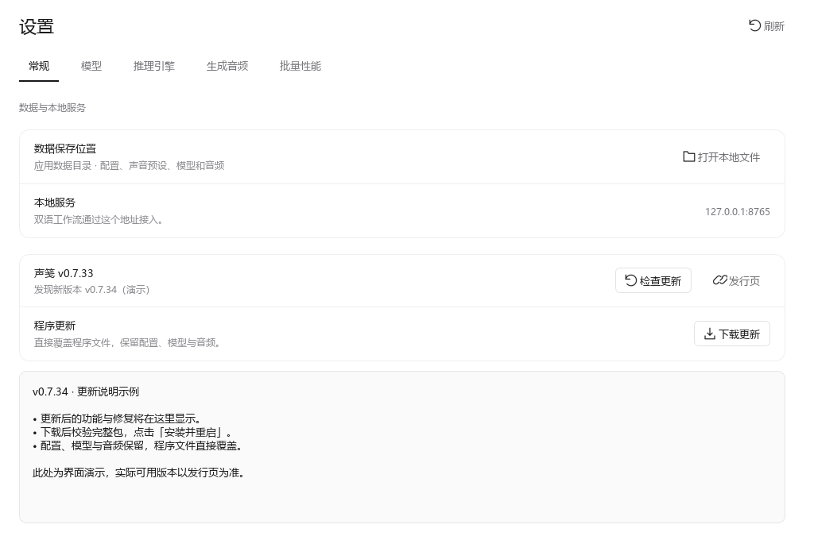
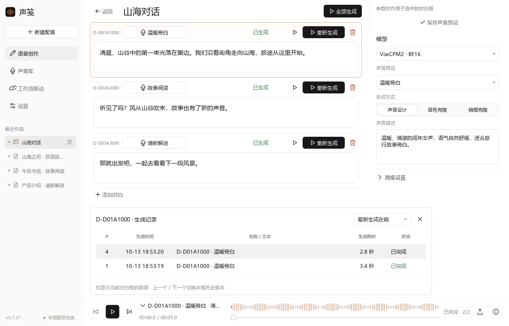
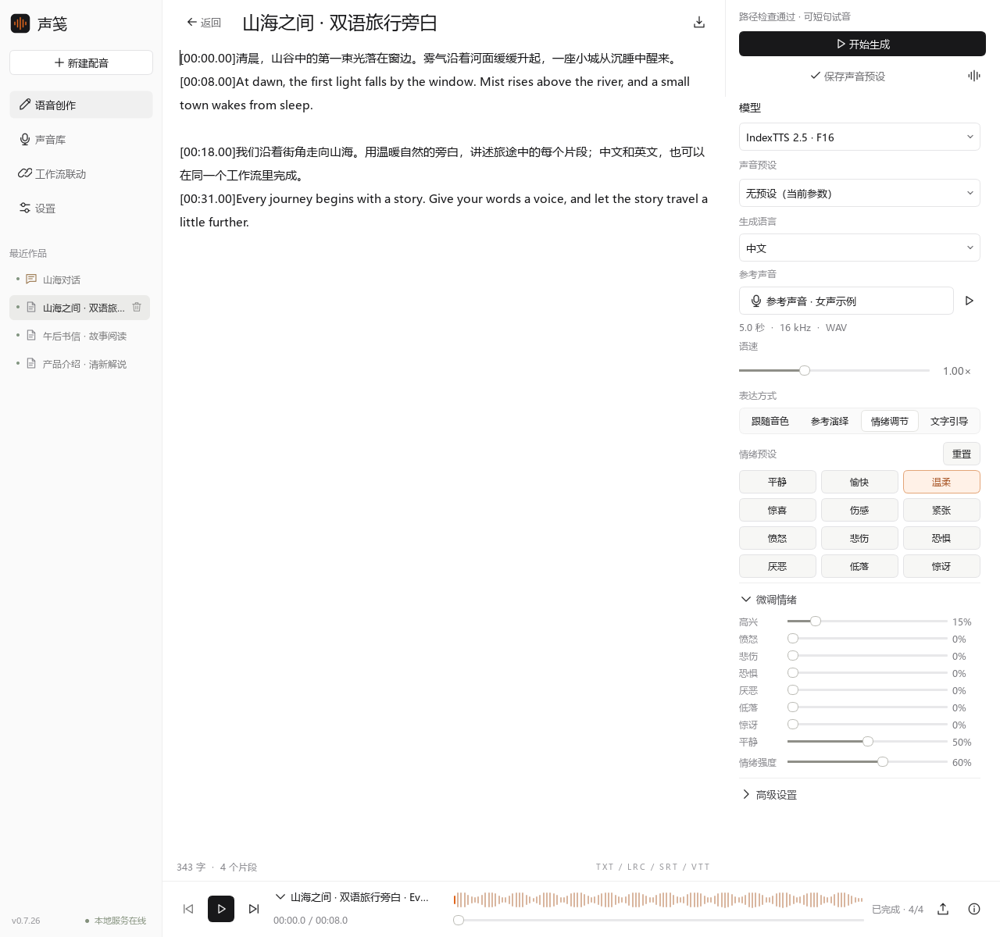
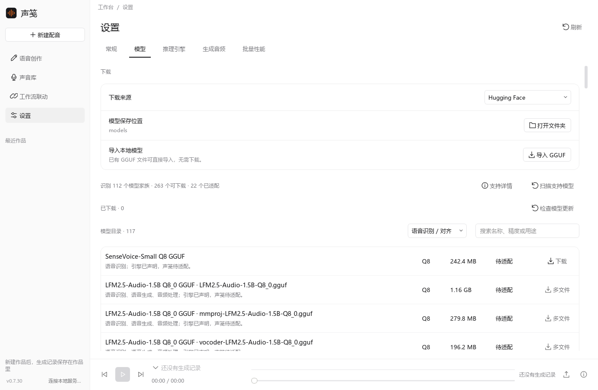
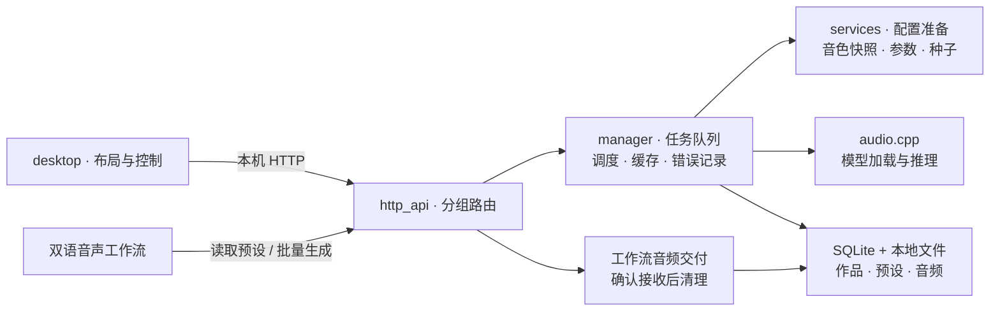

<div align="center">


# 声笺 · Shengjian TTS

**让文字拥有声音，让配音融入你的工作流。**

本地语音生成 · 多角色对话 · 音频编辑 · 语音识别 · 双语工作流联动

<p>
  
  
  <a href="LICENSE"></a>
</p>

[下载 Windows 版](https://github.com/weizhigao21/shengjian-tts/releases/latest) · [快速开始](#快速开始) · [界面预览](#界面预览) · [代码结构](#代码结构)

[接口说明](API.md) · [UI 风格](UI_STYLE.md) · [更新记录](CHANGELOG.md) · [第三方声明](THIRD_PARTY_NOTICES.md)

</div>


<p align="center"><sub>v0.7.28 实际界面 · 截图使用演示文本与数据，生成耗时仅作界面示例。</sub></p>

## 版本与下载

**当前源码：v0.7.57。** Windows 发行包精简开发资料，安装说明和授权文本收进运行库目录。Qwen 一键安装支持运行环境国内加速，覆盖独立 Python、PyTorch 和 Qwen SDK；模型默认使用魔搭，也可选择 HF 镜像。推理引擎支持 ghfast、GH-Proxy、官方直连与失败切换，下载保留续传和校验。Qwen 批量后端支持编码预测专用循环、启动条数门槛和实际推理状态；测速每组 20 条，只比较两端都生效的采样参数。详见[批量推理说明](docs/BATCH_INFERENCE.md)与[更新记录](CHANGELOG.md)。

**未发布实验：** CUDA Graph 默认关闭，已在本机 RTX 2080 Ti 完成编码 / 随机数 / 音频一致性、取消恢复及回退验证。20 条中文和中英混合短句相对当前专用批量循环的热模型耗时均减少约 50%，详见[验证报告](docs/CUDA_GRAPH_VALIDATION.md)。现有 v0.7.50 构建包不包含此实验功能。

**已发布 Windows 包：v0.7.28 · Windows x64 · 解压即用，无需安装 Python。** 当前本地构建包尚未上传发行页。独立 Qwen 批量后端可在设置页一键下载专用环境，无需预装 Python。

从 [v0.7.28 发行页](https://github.com/weizhigao21/shengjian-tts/releases/tag/v0.7.28) 下载 `shengjian-v0.7.28-windows-x64.zip`。同页提供对应源码包与 `SHA256SUMS.txt`。模型和 audio.cpp 引擎在程序内按需下载，首次下载需要网络；准备完成后可本地生成。

## 可以做什么

| 功能 | 使用方式 |
| :--- | :--- |
| **语音创作** | 新建时选择文章或对话，类型创建后固定；文章支持 TXT / LRC / SRT / VTT，按片段生成。 |
| **按模型配置** | 根据模型实际能力显示音色、克隆、声音设计和高级参数，支持固定随机种子。 |
| **IndexTTS 情绪控制** | 2.0 / 2.5 支持跟随音色、参考演绎、情绪调节和文字引导，提供 12 个预设、八维微调与强度设置。 |
| **多角色对话** | 输入 `@` 选择音色，为每框命名角色、调整参数并单独生成；选中框后，播放器和历史列表只显示它的音频。 |
| **音频编辑** | 导入 PCM WAV 或打开生成记录，拖动选区、裁剪 / 拼接 / 调整音量，保留各次版本；可接入 Vevo2 换声和台词修改。 |
| **语音识别** | 拖入音频自动转写文字，按标点分行并给出每行时间范围；点击任意一行播放对应片段，结果可导出 SRT / TXT。 |
| **声音库** | 保存声音预设、导入参考音频；在生成记录列表或音频管理中右键，把生成音频保存为参考声音。 |
| **音频管理** | 文章 / 对话分类，默认最新在前；对白按 ID 关联全部历史音频，支持详情、搜索与批量删除。 |
| **模型与引擎** | 自动扫描引擎模型、补全下载目录，按用途筛选；支持校验、更新、回退及 CPU / NVIDIA CUDA。 |
| **程序更新** | 检查 GitHub 正式发行，查看说明、下载校验并安装重启；直接覆盖程序文件，保留配置和数据。 |
| **工作流接入** | 通过本机链接读取预设，批量配音；工作流记录不挤占侧栏作品列表。 |

## 界面预览

点击图片查看原图。截图使用演示数据。





音频编辑截图使用测试音频；Vevo2 需要另行安装，实际模型效果尚待验证。[使用说明](docs/AUDIO_EDITING.md)

<details>
<summary>程序更新入口</summary>



截图使用模拟发行说明。v0.7.28 等旧包先手动安装含更新器的完整包，之后可在程序内更新。[更新说明](docs/APP_UPDATES.md)

</details>

<details>
<summary>对白历史与 IndexTTS 情绪面板</summary>





音色与演绎参考分开选择，情绪设置可保存到声音预设或单条对白。

</details>

<table>
  <tr>
    <td width="50%" align="center">
      <a href="docs/images/voice-library.png"></a>
      <br /><b>声音库</b><br /><sub>保存常用音色，复用声音预设</sub>
    </td>
    <td width="50%" align="center">
      <a href="docs/images/models.png"></a>
      <br /><b>模型管理</b><br /><sub>下载、导入与检查模型更新</sub>
    </td>
  </tr>
  <tr>
    <td width="50%" align="center">
      <a href="docs/images/audio-manager.png"></a>
      <br /><b>生成音频管理</b><br /><sub>查看生成记录，试听与批量清理</sub>
    </td>
    <td width="50%" align="center">
      <a href="docs/images/workflow.png"></a>
      <br /><b>双语工作流联动</b><br /><sub>一个本机链接，接入保存好的声音</sub>
    </td>
  </tr>
</table>

<details>
<summary>查看底部播放器与生成列表</summary>


点击音频名称展开历史列表；手动播放只试听当前片段，结束后停止。

右键某条已完成记录 →「保存到声音库…」，可修改声音名称和参考原文，保存后在「声音库 → 参考声音」中查看。参考音频需要 1–60 秒；较长片段可先通过「编辑音频」裁剪。

播放与试听跟随系统默认音频输出；在 Windows 中切换喇叭 / 耳机，无需重启声笺。切换不会清空当前片段或重置播放器音量。

</details>

## 快速开始

1. **打开程序**：解压整个文件夹，双击 `声笺.exe`。保留同目录的 `声笺服务.exe` 和完整 `_internal/`。
2. **准备引擎与模型**：在「设置 → 推理引擎」选择计算设备并安装，在「设置 → 模型」下载或导入兼容 GGUF。模型列表可查看大小与精度；按本机内存、显存选择。系统语音也可用于基础试用。
3. **创建配音**：点击「语音创作」或「新建配音」，选择文章或对话，配置声音后生成。常用配置可保存为声音预设。

| 模式 | 操作 |
| :--- | :--- |
| **文章** | 输入长文或导入 TXT / LRC / SRT / VTT，在右侧统一配置声音与参数，点击「开始生成」。 |
| **对话** | 输入 `@` 选择已保存的音色预设，自动创建对白框；Enter 新增下一条，Shift+Enter 换行。点击对白框调整它的参数，逐条生成或整批生成。 |
| **语音识别** | 拖入音频立即显示文件名和导入状态；模型旁可下载识别 / 对齐模型，完成后点行播放或导出字幕，最近作品可回到记录。 |

文章 / 对话在创建后固定。对白左上角可填写角色名称；命名后隐藏短 ID，悬停约 1.2 秒可查看完整 ID、音色、模型与音频数量。修改名字保留原 ID 和历史音频，修改文本或参数后可点击回转箭头重新生成。

本版支持逐框播放与导出，整段对话拼接导出、顺序拖动与停顿设置列入[后续计划](docs/DIALOGUE_MODE_PLAN.md)。

<details>
<summary>从源码启动（Windows / Python 3.10+）</summary>

```powershell
git clone https://github.com/weizhigao21/shengjian-tts.git
cd shengjian-tts
.\install.bat
.\launch.bat
```

仅运行本机 API 服务：

```powershell
python -m voice_workbench serve --port 8765
```

</details>

### 模型能力

统一推理引擎为 [audio.cpp](https://github.com/0xShug0/audio.cpp)，功能按实际模型包的能力显示。引擎版本与可用更新见「设置 → 推理引擎」。

「设置 → 模型」首次读取或更换引擎后自动扫描，也可点击「扫描支持模型」。目录区分**已适配**和**待适配**：以下四类模型可用于配音，其他单文件 GGUF 可下载保存，暂不创建声音预设；多文件包暂不自动安装。支持详情列出引擎声明的全部模型家族，扫描失败保留原有目录。

已下载和可下载列表显示**发布时间**，取当前 GGUF 文件版本的仓库提交日期；悬停查看完整时间及来源，未提供日期时显示「未知」。更新和回退后，日期跟随实际安装的文件版本。



| 模型 | 生成方式 |
| :--- | :--- |
| **IndexTTS 2.0 / 2.5** | 参考声音克隆；跟随音色、参考演绎、情绪调节和文字引导 |
| **VoxCPM2** | 声音克隆、精细克隆、声音设计 |
| **Qwen3-TTS** | Base：克隆；CustomVoice：内置音色与风格指令；VoiceDesign：声音设计 |
| **Kokoro** | 模型内置音色 |

高级设置支持随机或固定种子。调整参数后点击「参数预设 → 保存」并命名；下拉选择已保存的预设即可套用，旁边的管理按钮可更新、重命名、删除或刷新。预设仅保存当前模型的高级生成参数，不包含音色、参考声音、语速、情绪与运行环境；更换模型会筛选对应预设，不会自动套用。随机种子仍按每次随机保存，固定种子保存其具体值。参数变动会标记「已调整」；使用「恢复默认参数」可回到模型默认值。切换模型或生成方式后重新选择声音；修改预设参数后保存，工作流才会使用新配置。具体功能与性能取决于模型、精度和计算设备。

## 双语工作流联动

**保存声音预设 → 复制接入链接 → 工作流读取音色 → 批量生成**

在声笺「工作流联动」复制链接，默认地址：

```text
http://127.0.0.1:8765/workflow
```

双语工作流选择「API 服务器」，粘贴链接，点击「读取音色」，选择预设后开始生成。修改预设后刷新音色；生成期间保持声笺服务运行。

工作流只保存数据库生成记录，不创建侧栏作品。音频成功交付到工作流后删除声笺临时副本；整批完成后未接收的音频 1 小时后清理。工作流自己的输出音频保留。

未发布源码已支持工作流整批入队、完成一条接收一条：更新适配器后，单个声笺 API 的批量模式由服务统一合批，工作流微批大小不再限制 Qwen 的合批数量。可暂停后续生成、继续或取消，已下载音频保留；旧服务和多个 API 仍使用原流程。

<details>
<summary>旧版工作流适配与批量性能</summary>

给已有双语工作流源码安装适配器，替换路径为你的项目目录；脚本修改前自动备份：

```powershell
python scripts/install_workflow_adapter.py --target "D:\双语音声工作流"
```

安装后重新打包工作流，或从源码启动；旧 API 调用仍兼容。

「设置 → 批量性能」默认 1 个推理实例，工作流并发可设 1–4。多个实例独立加载模型，需结合显存与实际耗时选择。

接口字段、配置版本与交付确认见 [API.md](API.md)。

</details>

<details>
<summary>推理引擎升级与模型更新</summary>


- **引擎**：检查官方正式版，下载、校验与启动验证通过后切换，旧引擎可回退；计算设备可选 CPU 或 NVIDIA GPU。
- **引擎下载来源**：可选自动切换、GH-Proxy、ghfast 或 GitHub 官方直连。自动模式在失败时依次换源；暂停后可手动换源续传。第三方仅提供文件传输，仍使用官方文件大小和 SHA-256 校验，版本检查使用 GitHub 官方接口。
- **模型**：比较仓库版本与文件摘要，校验后切换，保留声音预设与旧模型；手动导入的本地模型可自行替换。
- **版本显示**：界面显示实际安装版本，无法识别的外部引擎显示「版本未知」。

</details>

## 常用说明

已创建任务的草稿会自动保存；暂时提交失败时，待存内容留在本地，连接恢复后重试。源码中的体检修复与性能数据见 [优化记录](docs/OPTIMIZATION.md)。

<details>
<summary>作品、生成耗时与参考声音</summary>

- 作品可重命名、删除和撤销；任务列表用图标区分文章和对话，时间记录在详情中。
- 对白框、生成记录和侧栏任务行都可以直接拖到其他程序：拖起时交出真实 WAV 文件，播放器、音频编辑软件、聊天窗口都能接收，不需要先导出。
- 音频列表默认最新在前，可切换排序。生成耗时包含推理时的模型加载，不含排队；缓存与旧记录分别显示「缓存」「未记录」。
- 手动播放结束后停止；再次生成保留旧音频。对话中角色名字可以相同，历史记录仍按每框的固定 ID 区分。
- 「设置 → 生成音频」右键可添加为参考音频，自动带入文本。参考声音为 1–60 秒 WAV，保存独立副本。

</details>

<details>
<summary>数据保存、更新与排错</summary>

| 启动方式 | 默认数据目录 |
| :--- | :--- |
| 安装版 | `%LOCALAPPDATA%\声笺\data` |
| 源码版 | 项目 `data/` |
| 指定目录 | 启动时传入 `--data-dir <路径>` |

设置页显示实际目录，可点击「打开本地文件」。数据库为 `tasks.sqlite3`，配置为 `config.json`；音频、参考声音、模型和引擎分别保存在 `audio/`、`voices/`、`models/`、`runtime/`。

**更新**：退出界面与独立服务，将新版程序文件覆盖到原目录。保留配置与用户数据文件夹，正常更新不创建旧程序备份。首次从旧文件夹包升级时自动复制原 `data/` 到用户目录，已有用户数据库不会被覆盖。

**排错**：生成失败可查看原因并重试失败片段。日志在数据目录 `logs/`，引擎日志为 `audio-cpp.log`。服务无法启动时检查端口、目录权限和已有服务，在「工作流联动 → 服务日志」重新连接。同一数据目录只允许一个服务实例。

</details>

<details>
<summary>Windows 一键打包</summary>

```powershell
.\打包.bat --no-pause
```

脚本检查依赖，缺少 pip 时用 ensurepip 补齐。输出 `dist/声笺/` 与版本 ZIP，根目录仅保留主程序、服务、更新器、`_internal` 和 `program-files.json`。简明安装说明保存在 `_internal/docs/`，完整第三方授权文本保存在 `_internal/legal/`；开发文档与截图留在源码中。包内不含个人数据库、音色、音频、模型或 audio.cpp 引擎。验证成功后直接覆盖程序文件，清理已知旧版文档并保留配置和数据，移除本次临时构建目录。

复建首个发行版可使用 CPython 3.10.11，在虚拟环境安装 `requirements-release.txt` 后运行 `python scripts/build_package.py`。依赖来源和许可见 `licenses/README.md`；更新依赖时可用 `python scripts/collect_licenses.py` 刷新清单。

</details>

## 代码结构

Python / PyQt6 + FastAPI + audio.cpp。界面与服务分进程运行，通过本机 HTTP 通信。桌面按布局和交互职责拆分，接口按功能分组，生成配置准备与任务调度分别管理。详见[代码架构](docs/ARCHITECTURE.md)。



<details>
<summary>展开完整代码目录</summary>

```text
集成文本生语音程序/
├─ voice_workbench/                 主程序
│  ├─ __main__.py                   GUI / 服务命令行入口
│  ├─ __init__.py                   版本号
│  ├─ desktop/                     桌面实现
│  │  ├─ window.py                主窗口装配与 Qt 生命周期
│  │  ├─ api_client.py            异步 HTTP 请求与响应解析
│  │  ├─ draft_saves.py           草稿快照、按任务保存与断线恢复
│  │  ├─ voice_checks.py          界面校验缓存与文件版本检查
│  │  ├─ constants.py             状态文字
│  │  ├─ model_labels.py          模型身份及显示名称
│  │  ├─ components/
│  │  │  ├─ voice_mentions.py     @ 预设列表、悬停与标签身份
│  │  │  └─ dialogue.py           音色标签、对白文本框及行操作
│  │  ├─ controllers/
│  │  │  ├─ creation.py           模式切换、对白操作与编辑状态
│  │  │  ├─ documents.py          作品列表、编辑、保存与导航
│  │  │  ├─ generation.py         生成提交与模型参数交互
│  │  │  ├─ playback.py           记录、试听、播放与导出
│  │  │  ├─ recognition.py        语音识别采集、拖动导入与点行播放
│  │  │  ├─ service.py            服务连接、轮询与状态
│  │  │  └─ voices.py             预设、参考声音与联动配置
│  │  ├─ layout/
│  │  │  ├─ creation.py           文章 / 对话选择页
│  │  │  ├─ workspace.py          主框架、侧栏与导航装配
│  │  │  ├─ generation.py         文本编辑与参数面板
│  │  │  ├─ player.py             播放器与记录浮层
│  │  │  ├─ recognition.py        语音识别页面、拖放区与分行列表
│  │  │  ├─ workflow.py           工作流页面
│  │  │  └─ common.py             布局辅助组件
│  │  └─ settings/
│  │     ├─ panel.py              设置装配与刷新
│  │     ├─ common.py             分组、表格及格式化
│  │     ├─ models.py             模型管理
│  │     ├─ engine.py             引擎与运行库管理
│  │     ├─ audio.py              生成音频管理
│  │     └─ preferences.py        常规与批量性能设置
│  ├─ http_api/                    HTTP 路由
│  │  ├─ context.py               共享请求上下文与作品查询
│  │  ├─ system.py                健康、性能与服务控制
│  │  ├─ models.py                模型与引擎接口
│  │  ├─ voices.py                预设与参考声音接口
│  │  ├─ jobs.py                  作品及生成接口
│  │  ├─ audio.py                 音频与日志接口
│  │  ├─ recognition.py           识别模型选项与识别记录接口
│  │  ├─ workflow.py              发现与临时音频交付
│  │  └─ legacy.py                旧推理接口
│  ├─ services/                    可复用应用服务
│  │  ├─ generation.py            配置快照、参数、种子及来源准备
│  │  ├─ dialogue.py              对白内容与声音配置版本
│  │  ├─ script_voices.py         行首音色解析与逐段生成配置
│  │  └─ service_lock.py          数据目录服务实例锁
│  ├─ recent_works.py             四类创作任务的只读最近作品摘要
│  ├─ speech_recognition/          语音识别：分行、引擎调用与会话存储
│  │  ├─ lines.py                 时间戳换算、标点回填与分行
│  │  ├─ runner.py                同一引擎进程内的识别与对齐请求
│  │  ├─ service.py               模型选择、音频导入、执行与结果
│  │  ├─ store.py                 识别会话 SQLite 存储
│  │  └─ schemas.py               识别请求与状态结构
│  ├─ gui.py                       桌面启动与旧导入的兼容入口
│  ├─ gui_layout.py                旧布局与模型名称函数的兼容导出
│  ├─ service_status.py            本地服务启动错误的中文诊断
│  ├─ ui.py                        通用组件、浮层、波形、图标与样式
│  ├─ model_controls.py            模型、生成方式、参考声音与运行环境控件
│  ├─ generation_controls.py       根据参数定义构建高级设置控件
│  ├─ parameter_preset_controls.py 参数预设选择、保存与管理控件
│  ├─ parameter_presets.py         参数持久化、模型范围与兼容性校验
│  ├─ library.py                   预设、参考声音列表与编辑弹窗
│  ├─ settings.py                  旧设置面板的兼容入口
│  ├─ api.py                       FastAPI 装配、生命周期、错误与访问处理
│  ├─ workflow.py                  工作流音色发现、可用状态与配置版本
│  ├─ workflow_audio.py            工作流临时音频、接收确认、到期与历史清理
│  ├─ schemas.py                   请求与声音配置的数据结构、字段校验
│  ├─ manager.py                   任务队列、锁、独立推理实例、恢复与缓存
│  ├─ model_management.py          模型目录、下载续传、校验、导入与删除
│  ├─ engine_management.py         统一推理引擎下载、解压、安装与切换
│  ├─ engine_updates.py            官方正式版、Windows 下载包与摘要检查
│  ├─ model_updates.py             固定模型提交、文件大小与 SHA-256 发现
│  ├─ model_dates.py               文件版本发布时间、批量查询与日期校验
│  ├─ model_scan.py                引擎模型声明、官方目录扫描与离线缓存
│  ├─ engine_validation.py         Windows x64 文件头、计算后端与 DLL 依赖验证
│  ├─ downloads.py                 模型和引擎共用的续传与文件校验
│  ├─ audio_cpp.py                 统一后端选择、原生引擎进程与请求适配
│  ├─ native_paths.py              中文模型路径兼容、临时硬链接及清理
│  ├─ runner.py                    配置和 WAV 校验、Python 推理进程管理
│  ├─ engine_worker.py             Python 推理子进程入口
│  ├─ model_info.py                读取 GGUF / 引擎声明的模型能力
│  ├─ generation_options.py        高级参数定义、范围与值校验
│  ├─ config.py                    配置持久化、声音预设与参考声音管理
│  ├─ runtime.py                   源码 / EXE 路径、后台入口与外部 DLL 环境
│  ├─ data_paths.py                固定用户数据目录、旧数据库迁移与内部路径修复
│  ├─ discovery.py                 发现已有 yovoice 引擎、模型与参考资产
│  ├─ store.py                     SQLite 作品、片段、历史快照与缓存记录
│  ├─ naming.py                    未命名作品自动命名
│  ├─ subtitles.py                 文本与 TXT / LRC / SRT / VTT 解析
│  ├─ errors.py                    错误代码、阶段、原因与恢复建议
│  └─ assets/                      程序图标、模型及引擎下载目录、来源许可
├─ integration/                    双语工作流适配器、配置及安装备份
│  ├─ local_voice_client.py        音色发现、版本固定、批次下载与保存后确认
│  └─ local_voice_picker.py        工作流中的链接接入、音色选择与刷新控件
├─ docs/                           项目文档与界面截图
│  ├─ ARCHITECTURE.md              分层规则与模块职责
│  ├─ DIALOGUE_MODE_PLAN.md        对话设计与后续计划
│  ├─ OPTIMIZATION.md             体检优化、测量与验证记录
│  └─ images/                     实际界面截图
├─ scripts/                        联动安装、快捷方式、图标与验证脚本
│  ├─ build_package.py             打包、产物验证与程序覆盖发布
│  ├─ package_files.py             程序文件替换、占用检查与数据保护
│  ├─ collect_licenses.py          构建依赖与原始许可证清单
│  ├─ frozen_entry.py              界面 EXE 与后台服务 EXE 的共同入口
│  ├─ check_engine_download.py     真实引擎下载、暂停续传、安装与推理检查
│  ├─ render_readme.py             隔离演示数据，渲染 README 界面截图
│  └─ check_packaged_app.py        发布包启动、引擎安装、真实配音与退出检查
├─ docs/
│  ├─ ARCHITECTURE.md               模块职责、目录与依赖规则
│  ├─ DIALOGUE_MODE_PLAN.md         当前对话功能与后续计划
│  └─ images/                      README 项目图标与界面截图
├─ tests/                          服务、模型、任务、界面与资产管理测试
├─ data/                           源码默认数据；安装版使用用户目录下的同结构
│  ├─ config.json                  模型路径、声音预设与参考声音配置
│  ├─ tasks.sqlite3                作品、生成片段、快照与缓存索引
│  ├─ audio/                       生成的 WAV 文件
│  ├─ workflow-audio/              工作流临时 WAV，接收确认后删除
│  ├─ models/                      下载模型及未完成的下载文件
│  ├─ runtime/                     下载的统一引擎、运行库及未完成的安装包
│  ├─ voices/                      导入或复制的参考音频
│  ├─ logs/                        片段错误与推理引擎日志
│  └─ temporary/                   运行时临时文件
├─ artifacts/                      验证输出与界面预览
├─ launch.bat                      Windows 启动脚本
├─ install.bat                     环境依赖安装脚本
├─ 打包.bat                        Windows 一键打包脚本
├─ 声笺.spec                       图标、资源、依赖与双 EXE 打包配置
├─ pyproject.toml                  Python 打包、依赖与测试配置
├─ requirements-release.txt        v0.7.28 发行版的固定构建环境
├─ LICENSE                        GPLv3 许可证
├─ licenses/                      依赖版本、来源与完整许可声明
├─ README.md                       使用说明与代码结构
├─ API.md                          本机接口与工作流音频交付说明
├─ UI_STYLE.md                     可供其他程序复用的 UI 风格规范
├─ CHANGELOG.md                    版本更新记录
└─ THIRD_PARTY_NOTICES.md           第三方来源与许可说明
```

</details>

| 要修改什么 | 从这里开始 |
| :--- | :--- |
| 布局与组件 | `desktop/layout/`、`desktop/controllers/`、`ui.py`；跨程序复用参考 [UI_STYLE.md](UI_STYLE.md) |
| 模型与高级参数 | `model_info.py`、`generation_options.py`、后端适配 |
| 任务与数据 | `services/generation.py`、`manager.py`、`store.py` |
| 工作流与接口 | `http_api/`、`api.py`、`integration/`；字段说明见 [API.md](API.md) |

<details>
<summary>开发验证与截图更新</summary>

```powershell
python -m pip install -e ".[test]"
python -m pytest -q
python scripts/check_packaged_app.py
python scripts/check_advanced_generation.py
```

实际推理检查需要对应模型、引擎与正常 Windows 用户权限。

使用已配置的 VoxCPM2、Qwen3 CustomVoice、Kokoro 模型刷新演示截图：

```powershell
python scripts/render_readme.py
```

脚本在临时目录构建演示数据，不执行推理；读取模型元信息，不修改用户配置，不导出个人文本或音频。

</details>

## 许可与反馈

声笺源代码按 [GPLv3](LICENSE) 发行，Copyright © 2026 weizhigao21。依赖、参考项目和模型分别遵循各自的许可，详见[第三方声明](THIRD_PARTY_NOTICES.md)与[依赖清单](licenses/README.md)。

遇到问题可提交 [Issue](https://github.com/weizhigao21/shengjian-tts/issues)，附上程序、模型和引擎版本、复现步骤及相关日志；提交前移除个人文本和本机路径。
