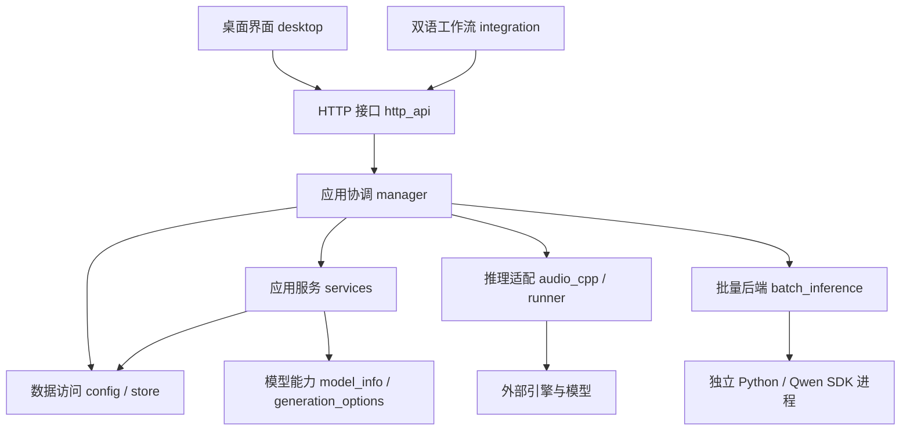

# 代码架构

声笺 v0.7.50 按桌面交互、HTTP 接口、应用服务、任务调度、数据访问与推理适配组织代码。对话功能与后续计划见 [DIALOGUE_MODE_PLAN.md](DIALOGUE_MODE_PLAN.md)，音频编辑见 [AUDIO_EDITING.md](AUDIO_EDITING.md)，语音识别见 [SPEECH_RECOGNITION.md](SPEECH_RECOGNITION.md)，批量推理见 [BATCH_INFERENCE.md](BATCH_INFERENCE.md)，程序更新见 [APP_UPDATES.md](APP_UPDATES.md)。

## 分层



## 依赖规则

- 桌面端通过本机 API 修改数据，控件负责展示和交互，控制模块负责请求与页面状态。
- HTTP 路由按功能分组，负责字段接收、调用应用层和响应，不直接控制 Qt 或推理进程。
- 应用服务负责配置准备等用例逻辑；队列管理器负责锁、排队、调度、缓存和生命周期。
- 数据访问层管理配置文件、SQLite 和快照；模型能力与推理适配保持独立。
- 后端导入不加载 PyQt；桌面包的 `__init__.py` 不隐式初始化应用。
- 跨模块共享行为放入明确的公共模块，不从路由文件或主窗口反向导入。
- 现有 `voice_workbench.gui` 等外部入口保留兼容导出，后续代码优先使用新目录中的实现。

## 模块职责

1. 主窗口拆分为窗口装配、服务连接、作品编辑、声音库交互与播放控制。
2. 页面构建与生成参数交互分开，避免布局文件继续承载任务业务逻辑。
3. 设置页按通用组件、模型、推理引擎、音频管理和批量性能组织。
4. FastAPI 路由按系统、模型/引擎、声音库、作品、音频、工作流及旧接口分组。
5. 提取生成配置准备和服务实例锁，供现有提交与后续对白提交复用。
6. 更新代码目录说明和分发文档，验证源码与文件夹包入口。

v0.7.22 在原分层中增加文章 / 对话入口、对白组件及创作控制器。作品的 `editor_state` 保存两种编辑内容，片段的稳定来源 ID 和内容版本关联对白，单条重新生成复用原队列并跳过缓存。数据库只增列，迁移前自动备份；HTTP 路径、声音预设及工作流规则保留。

v0.7.23 由创作控制器统一选择范围，播放控制器按 `source_id` 筛选当前框的记录；条目保存局部模型与参数，生成服务准备每条独立快照。片段 `content_type` 固定生成时的文章 / 对话类型，SQLite 分类视图和来源索引复用同一数据库，音频管理按分类筛选。

v0.7.24 由入口卡片创建对应类型的草稿，文稿控制器的新建操作只重置编辑器并显示入口。任务创建后类型固定，Store 在保存和追加前校验类型，省略编辑状态时沿用已有状态。生成布局按任务类型放置按钮：文章在右侧，对话在框内及顶部；列表使用同一 SVG 图标系统表示任务类型。

v0.7.26 将 IndexTTS 表达方式拆为 `index_emotion.py`（标准库参数契约，供两个引擎复用）与 `index_emotion_controls.py`（Qt 面板）。生成服务保留演绎参考并固定每条对白的参数快照；配置与音频生命周期共同保护两种参考文件。新增字段可选，旧预设的默认版本标签兼容。

v0.7.28 的 `role_name` 只负责角色显示，音频关联仍使用稳定的对白 ID；悬停详情由独立组件 `delayed_tooltip.py` 管理。程序文件替换策略在 v0.7.33 提取至 `program_files.py`，构建脚本的 `package_files.py` 保留兼容导入；构建和更新都只覆盖程序文件，保留配置与数据，不创建旧程序备份。

v0.7.29 将待存草稿提取为 `desktop/draft_saves.py`：按任务保存独立快照与递增版本，旧响应只能确认旧版本，导航不会清空排队内容。`pending-drafts.json` 是待提交的恢复记录，正式作品仍通过 API 写入 SQLite。生成成功确认对应快照，失败恢复自动保存；新建任务退出时先接收任务 ID。`desktop/voice_checks.py` 负责界面短缓存，模型、参考文件或参数变化会重新校验，服务端生成前仍完整检查。

原生路径清理保留尚被映射的自有别名，下一次停止或全实例退出时再试；管理器先停止全部实例，再重试清理。健康检查直接统计任务状态；设置按页请求，对白记录按来源 ID 分组。优化范围和验证见 [OPTIMIZATION.md](OPTIMIZATION.md)。

v0.7.30 的 `model_scan.py` 独立管理引擎声明、后台仓库扫描和缓存；`model_updates.py` 复用远程元数据校验。`model_management.py` 负责目录合并、下载及安装记录，桌面端只筛选和显示状态。引擎声明不等于配音适配：单文件待适配模型下载后只登记文件，多文件包不进入自动安装。扫描生命周期随管理器关闭，模型声明按文件签名缓存。详见 [MODEL_DISCOVERY.md](MODEL_DISCOVERY.md)。

v0.7.31 的 `model_dates.py` 负责 GGUF 文件版本日期的批量查询、UTC 校验和缓存回退。日期绑定文件校验值与安装记录，更新目录不会改变仍在使用的旧文件日期；Qt 设置页负责转换为本地时间显示。

v0.7.36 的 `parameter_presets.py` 管理独立的高级参数预设，复用 `generation_options.py` 的兼容处理与严格校验。`http_api/parameter_presets.py` 提供管理接口，`parameter_preset_controls.py` 由主检查器和声音预设编辑窗口复用。预设写入 `config.json` 的可选 `parameter_presets` 列表，与其他配置共用锁和原子替换；仅保存高级参数与模型关联信息。读取时重新计算模型标识，以兼容数据目录迁移；选择时再按当前模型契约校验，异步回调固定保存时的模型和参数快照。

v0.7.37 新增 `speech_recognition/`：`runner.py` 在一个统一引擎进程内声明 `asr` 与 `align` 两个模型，识别走 `/v1/audio/transcriptions`，词级时间走 `/v1/audio/alignments`，失败时回退 `/v1/tasks/run`；`lines.py` 把引擎的帧号时间戳与标点整理成可点击的行，`service.py` 负责模型选择、音频导入与执行，`store.py` 用独立的 SQLite 保存会话。识别模型按 `model_specs` 的任务声明登记，只进入该模式的模型列表，不生成声音预设；音频以 multipart 进入请求体，中文模型路径与音频暂存仍沿用 `native_paths.py` 的 ASCII 别名。识别的引擎占用与音频编辑共用管理器的推理互斥，两者的终止状态都在清除占用标记之后再发布。

v0.7.38 将识别的启动检查、状态提交与失败回滚放入管理器锁，`require_idle_engine` 供识别和 AI 编辑双向复用；耗时的音频解码在锁外完成，入库前再次检查占用。`audio_import.py` 调用独立的 `decode-audio` 服务入口，`decode_worker.py` 在子进程主线程运行 Qt 解码器，后端导入仍不加载 Qt。界面按会话与分行内容增量刷新，保留本地名称 / 语言编辑与播放状态。

v0.7.39 的 `recent_works.py` 只读汇总四类创作任务，供 HTTP 与桌面启动共用。外部任务使用带模式前缀的列表 ID，导航时用 `source_id` 访问独立模式 API，原作品接口与工作流过滤不变。识别控制器在发起导入请求前创建临时显示状态，成功替换、失败回滚；导航序号阻止迟到响应覆盖已切换的任务。模型入口复用设置页下载器与原文件校验。

v0.7.40 将模型目录分类放入 `desktop/settings/model_categories.py`，下载任务展示与操作放入 `model_transfers.py`，页面装配仍由 `models.py` 负责。`downloads.py` 统一计算本次传输的近期速度，下载状态快照清除过期速度；`model_management.py` 以 `speed_bps` / `update_speed_bps` 提供下载与更新速率。分类不影响独立任务区域，完成后移除展示，不改变文件校验与续传路径。

v0.7.41 的识别适配优先使用通用任务接口保留语言，路由不可用时回退简化转写接口；两种通用任务复用临时 ASCII 音频路径。`speech_recognition/languages.py` 管理语言名称与对齐能力，服务层在自动识别后解析具体语言，跳过空结果 / 无效语言的对齐请求，并在对齐失败时保留文字与估算行时间。取消优先于降级结果。

v0.7.42 的识别入库由 `desktop/controllers/recognition_references.py` 固定右键内容、安排后台裁剪并复用 `ReferenceDialog` 与 `/references`；`speech_recognition/reference_clip.py` 校验识别目录和选区，复用 PCM 渲染生成临时片段，原文件只读。对话框结束时释放预览源并清理临时音频，已有参考声音导入负责持久化独立副本。`RecognitionLines` 将右键选择与左键播放分开，现有识别 API 与数据库不变。

## 验证

v0.7.44 将自动合批策略、后端配置、进程协议和结果交付拆入 `batch_inference`。队列按同任务 / 生成批次原子认领有界兼容组；结果保留各条原始索引，取消共享一个组内事件。外部 SDK 只在工作进程中导入，模型、运行库及完整输入批次参与结果缓存隔离。API 添加可选执行偏好和只读计划，现有调用仍可使用默认路由。

v0.7.43 的 `ReferenceDialog` 以绑定方法订阅共享参考播放器的位置、时长、状态与音源信号，并同时校验试听来源按钮和文件路径。每个窗口只显示自己的进度，销毁时由 Qt 自动断开连接，不新增动画定时器或播放器。

v0.7.35 的生成记录右键菜单由 `desktop/controllers/playback.py` 捕获点击条目的音频、原文和作品名称，使用现有参考声音导入窗口及保存接口。菜单期间刷新或切换对白不改变待保存来源，源文件在打开保存窗口前再次检查；复制和引用生命周期仍由配置 / 文件管理层负责，不增加重复存储接口。

v0.7.34 的 `desktop/audio_output.py` 统一管理系统默认输出跟随。`QMediaDevices` 监视器属于各自的 `QAudioOutput`，收到默认输出 / 插拔通知后比较设备 ID，只在改变时重新绑定；四处播放器复用此策略，Qt 对象释放时自动断开通知，不需要轮询或重新创建播放器。通知依据 [Qt 默认输出契约](https://doc.qt.io/qt-6/qmediadevices.html#defaultAudioOutput-prop)。

v0.7.33 的 `app_updates/` 将发行解析 / 下载、清单校验和独立安装分离。Qt 页面只组织后台任务与进程交接，不在界面线程解压。更新器单独打包，不导入 Qt、后端或 HTTPX；包内文件清单和覆盖策略由构建及更新共用。`_vendor/pyupdater/` 仅保留有明确来源的配置、进程与进度窗原语。

v0.7.32 新增 `audio_editing/`，分别管理 PCM 处理、版本存储、应用服务和 Vevo2 请求。音频编辑通过单独的 API 和 SQLite 保存项目，复用原生服务启动；AI 处理与原配音队列在管理器锁下互斥。Qt 的页面、控制器和波形组件独立，不把音频编辑任务写入文章 / 对话数据库。

覆盖原服务、模型、任务、播放、界面、音频编辑、语音识别、文件管理和打包测试；增加后端独立导入、路由注册及生成准备检查。使用隔离目录验证安装包，验证期间不对用户数据库执行生成或迁移。

## 实际目录

```text
voice_workbench/
├─ desktop/                    桌面端
│  ├─ window.py                窗口装配、Qt 初始化和退出
│  ├─ api_client.py            异步 HTTP 请求与响应解析
│  ├─ audio_output.py          各处播放器跟随系统默认输出设备
│  ├─ draft_saves.py           按任务与版本保存草稿、断线恢复
│  ├─ voice_checks.py          界面校验缓存、文件与参数失效
│  ├─ constants.py             界面状态文字
│  ├─ model_labels.py          模型身份与显示名称
│  ├─ components/              可复用编辑组件
│  │  ├─ voice_mentions.py     @ 预设列表、悬停选择及标签身份
│  │  └─ dialogue.py           音色标签、对白文本框及行操作
│  ├─ controllers/             按职责组织的交互控制
│  │  ├─ creation.py           模式入口、编辑状态及单条对白操作
│  │  ├─ documents.py          作品列表、文稿、保存及导航
│  │  ├─ generation.py         生成提交、模型与预设参数交互
│  │  ├─ recognition.py        识别采集、拖动导入与点行播放
│  │  ├─ playback.py           生成记录、播放、波形与导出
│  │  ├─ service.py            服务连接、轮询和状态更新
│  │  └─ voices.py             预设、参考声音、试听与联动配置
│  ├─ layout/                  页面组件装配
│  │  ├─ creation.py           文章 / 对话选择页
│  │  ├─ workspace.py          侧栏与工作区框架
│  │  ├─ generation.py         文本编辑和参数面板
│  │  ├─ player.py             播放器和生成记录浮层
│  │  ├─ recognition.py        语音识别页面、拖放区和分行列表
│  │  ├─ workflow.py           工作流连接页面
│  │  └─ common.py             小型布局辅助函数
│  └─ settings/                设置页
│     ├─ panel.py              页签装配、刷新与生命周期
│     ├─ common.py             分组、表格与格式化组件
│     ├─ models.py             模型导入、下载、更新和删除
│     ├─ engine.py             引擎与运行库管理
│     ├─ audio.py              音频列表、试听、参考导入及删除
│     └─ preferences.py        常规与批量性能设置
├─ http_api/                   HTTP 路由与请求上下文
│  ├─ context.py               获取服务实例与作品查询响应
│  ├─ system.py                健康检查、性能与服务控制
│  ├─ models.py                模型与引擎管理
│  ├─ voices.py                声音预设与参考声音
│  ├─ jobs.py                  作品、提交、批次、取消和重试
│  ├─ audio.py                 生成音频管理、文件和日志响应
│  ├─ workflow.py              工作流发现、临时交付与接收确认
│  ├─ recognition.py           识别模型选项、记录与音频接口
│  └─ legacy.py                旧 infer_single / infer_bulk 接口
├─ services/                   可复用应用服务
│  ├─ generation.py            PreparedGeneration 与生成配置准备
│  ├─ dialogue.py              对白内容及声音配置版本计算
│  ├─ script_voices.py         行首音色解析、UTF-16 位置与逐段配置
│  └─ service_lock.py          同一数据目录的服务实例锁
├─ recent_works.py             四类创作任务的只读摘要
├─ speech_recognition/         语音识别：分行、引擎调用与会话
│  ├─ lines.py                 时间戳换算、标点回填与分行
│  ├─ runner.py                同一引擎进程内的识别与对齐请求
│  ├─ service.py               模型选择、音频导入、执行与结果
│  ├─ store.py                 识别会话 SQLite 存储
│  └─ schemas.py               识别请求与状态结构
├─ api.py                      应用工厂、生命周期、错误与访问处理
├─ manager.py                  队列、锁、推理调度、缓存及恢复
├─ config.py / store.py        配置与 SQLite 数据访问
├─ model_info.py               GGUF 与引擎能力读取
├─ model_scan.py               引擎模型声明、后台扫描与缓存
├─ model_dates.py              文件版本日期、批量查询与校验
├─ generation_options.py       参数定义、适配与校验
├─ audio_cpp.py / runner.py    推理后端、进程和 WAV 校验
├─ gui.py / gui_layout.py       旧桌面入口的兼容导出
└─ settings.py                 旧设置入口的兼容导出
```

窗口约 900 行的混合实现已拆分，`desktop/window.py` 约 200 行；原布局与设置文件改为兼容入口，布局和设置各模块按职责组织。API 工厂从约 400 行收敛到约 50 行。

控制模块以 mixin 组合到主窗口，设置模块以 mixin 组合到设置面板；Qt 对象、定时器、异步请求和播放资源的生命周期仍由窗口及面板统一管理。共享状态显式通过所属窗口的属性访问，不通过跨模块全局变量保存。

## 后续扩展规则

- 对话模式的条目组件放在 `desktop/layout/`，交互控制放在 `desktop/controllers/`；业务用例进入 `services/`。
- 语音识别的时间戳换算和分行规则放在 `speech_recognition/`，页内拖放与点行播放放在 `desktop/`；识别会话独立存储，不写入作品数据库。
- `prepare_generation()` 返回声音快照、配置指纹和来源预设，可为多条对白分别准备配置；数据库提交及并发调度仍由应用协调层负责。
- 新接口增加独立路由模块并显式注册；新增数据通过版本迁移进入数据层。
- 文件继续增长时按新增职责拆分，不为单个函数建立无必要的包装层；当前内聚的模型、引擎和存储模块沿用现有位置。
- 原 `Window`、`SettingsPanel`、`create_app`、`ServiceLock` 导入保持可用。新代码优先引用实现模块，兼容文件只维护导出。

v0.7.45 新增 `batch_inference/discovery.py` 与 `provisioning.py`，将本地规格发现和异步环境 / 模型安装从推理解耦；桌面 `batch_setup.py` 管理安装入口、进度和状态刷新。安装只写数据目录，完成后在引擎空闲时应用配置，不在轮询或推理中下载。

v0.7.46 的 `batch_inference/benchmark.py` 使用独立原生 / 批量进程，在管理器引擎保留期间运行固定快照，不进入任务存储或成品缓存。桌面 `settings/benchmark.py` 在原设置轮询中接收进度并呈现冷 / 热报告；模型安装、配置、识别和编辑沿用引擎互斥约束。
