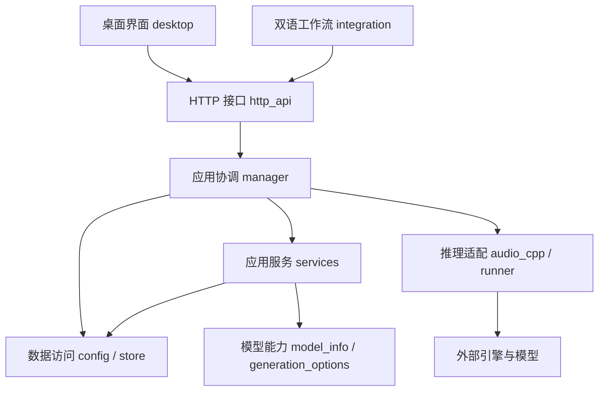

# 代码架构

声笺 v0.7.28 按桌面交互、HTTP 接口、应用服务、任务调度、数据访问与推理适配组织代码。对话功能与后续计划见 [DIALOGUE_MODE_PLAN.md](DIALOGUE_MODE_PLAN.md)。

## 分层



## 依赖规则

- 桌面端通过本机 API 修改数据，控件负责展示和交互，控制模块负责请求与页面状态。
- HTTP 路由按功能分组，负责字段接收、调用应用层和响应，不直接控制 Qt 或推理进程。
- 应用服务负责配置准备等用例逻辑；队列管理器负责锁、排队、调度、缓存和生命周期。
- 数据访问层管理配置文件、SQLite 和快照；模型能力与推理适配保持独立。
- 后端导入不加载 PyQt；桌面包的 `__init__.py` 不隐式初始化应用。
- 跨模块共享行为放入明确的公共模块，不从路由文件或主窗口反向导入。
- 现有 `voice_workbench.gui` 等外部入口保留兼容导出，后续代码优先使用新目录中的实现。

## 模块职责

1. 主窗口拆分为窗口装配、服务连接、作品编辑、声音库交互与播放控制。
2. 页面构建与生成参数交互分开，避免布局文件继续承载任务业务逻辑。
3. 设置页按通用组件、模型、推理引擎、音频管理和批量性能组织。
4. FastAPI 路由按系统、模型/引擎、声音库、作品、音频、工作流及旧接口分组。
5. 提取生成配置准备和服务实例锁，供现有提交与后续对白提交复用。
6. 更新代码目录说明和分发文档，验证源码与文件夹包入口。

v0.7.22 在原分层中增加文章 / 对话入口、对白组件及创作控制器。作品的 `editor_state` 保存两种编辑内容，片段的稳定来源 ID 和内容版本关联对白，单条重新生成复用原队列并跳过缓存。数据库只增列，迁移前自动备份；HTTP 路径、声音预设及工作流规则保留。

v0.7.23 由创作控制器统一选择范围，播放控制器按 `source_id` 筛选当前框的记录；条目保存局部模型与参数，生成服务准备每条独立快照。片段 `content_type` 固定生成时的文章 / 对话类型，SQLite 分类视图和来源索引复用同一数据库，音频管理按分类筛选。

v0.7.24 由入口卡片创建对应类型的草稿，文稿控制器的新建操作只重置编辑器并显示入口。任务创建后类型固定，Store 在保存和追加前校验类型，省略编辑状态时沿用已有状态。生成布局按任务类型放置按钮：文章在右侧，对话在框内及顶部；列表使用同一 SVG 图标系统表示任务类型。

v0.7.26 将 IndexTTS 表达方式拆为 `index_emotion.py`（标准库参数契约，供两个引擎复用）与 `index_emotion_controls.py`（Qt 面板）。生成服务保留演绎参考并固定每条对白的参数快照；配置与音频生命周期共同保护两种参考文件。新增字段可选，旧预设的默认版本标签兼容。

v0.7.28 的 `role_name` 只负责角色显示，音频关联仍使用稳定的对白 ID；悬停详情由独立组件 `delayed_tooltip.py` 管理。构建脚本用 `package_files.py` 仅覆盖程序文件，保留配置与数据，不创建旧程序备份。

## 验证

覆盖原服务、模型、任务、播放、界面、文件管理和打包测试；增加后端独立导入、路由注册及生成准备检查。使用隔离目录验证安装包，验证期间不对用户数据库执行生成或迁移。

## 实际目录

```text
voice_workbench/
├─ desktop/                    桌面端
│  ├─ window.py                窗口装配、Qt 初始化和退出
│  ├─ api_client.py            异步 HTTP 请求与响应解析
│  ├─ constants.py             界面状态文字
│  ├─ model_labels.py          模型身份与显示名称
│  ├─ components/              可复用编辑组件
│  │  ├─ voice_mentions.py     @ 预设列表、悬停选择及标签身份
│  │  └─ dialogue.py           音色标签、对白文本框及行操作
│  ├─ controllers/             按职责组织的交互控制
│  │  ├─ creation.py           模式入口、编辑状态及单条对白操作
│  │  ├─ documents.py          作品列表、文稿、保存及导航
│  │  ├─ generation.py         生成提交、模型与预设参数交互
│  │  ├─ playback.py           生成记录、播放、波形与导出
│  │  ├─ service.py            服务连接、轮询和状态更新
│  │  └─ voices.py             预设、参考声音、试听与联动配置
│  ├─ layout/                  页面组件装配
│  │  ├─ creation.py           文章 / 对话选择页
│  │  ├─ workspace.py          侧栏与工作区框架
│  │  ├─ generation.py         文本编辑和参数面板
│  │  ├─ player.py             播放器和生成记录浮层
│  │  ├─ workflow.py           工作流连接页面
│  │  └─ common.py             小型布局辅助函数
│  └─ settings/                设置页
│     ├─ panel.py              页签装配、刷新与生命周期
│     ├─ common.py             分组、表格与格式化组件
│     ├─ models.py             模型导入、下载、更新和删除
│     ├─ engine.py             引擎与运行库管理
│     ├─ audio.py              音频列表、试听、参考导入及删除
│     └─ preferences.py        常规与批量性能设置
├─ http_api/                   HTTP 路由与请求上下文
│  ├─ context.py               获取服务实例与作品查询响应
│  ├─ system.py                健康检查、性能与服务控制
│  ├─ models.py                模型与引擎管理
│  ├─ voices.py                声音预设与参考声音
│  ├─ jobs.py                  作品、提交、批次、取消和重试
│  ├─ audio.py                 生成音频管理、文件和日志响应
│  ├─ workflow.py              工作流发现、临时交付与接收确认
│  └─ legacy.py                旧 infer_single / infer_bulk 接口
├─ services/                   可复用应用服务
│  ├─ generation.py            PreparedGeneration 与生成配置准备
│  ├─ dialogue.py              对白内容及声音配置版本计算
│  ├─ script_voices.py         行首音色解析、UTF-16 位置与逐段配置
│  └─ service_lock.py          同一数据目录的服务实例锁
├─ api.py                      应用工厂、生命周期、错误与访问处理
├─ manager.py                  队列、锁、推理调度、缓存及恢复
├─ config.py / store.py        配置与 SQLite 数据访问
├─ model_info.py               GGUF 与引擎能力读取
├─ generation_options.py       参数定义、适配与校验
├─ audio_cpp.py / runner.py    推理后端、进程和 WAV 校验
├─ gui.py / gui_layout.py       旧桌面入口的兼容导出
└─ settings.py                 旧设置入口的兼容导出
```

窗口约 900 行的混合实现已拆分，`desktop/window.py` 约 200 行；原布局与设置文件改为兼容入口，布局和设置各模块按职责组织。API 工厂从约 400 行收敛到约 50 行。

控制模块以 mixin 组合到主窗口，设置模块以 mixin 组合到设置面板；Qt 对象、定时器、异步请求和播放资源的生命周期仍由窗口及面板统一管理。共享状态显式通过所属窗口的属性访问，不通过跨模块全局变量保存。

## 后续扩展规则

- 对话模式的条目组件放在 `desktop/layout/`，交互控制放在 `desktop/controllers/`；业务用例进入 `services/`。
- `prepare_generation()` 返回声音快照、配置指纹和来源预设，可为多条对白分别准备配置；数据库提交及并发调度仍由应用协调层负责。
- 新接口增加独立路由模块并显式注册；新增数据通过版本迁移进入数据层。
- 文件继续增长时按新增职责拆分，不为单个函数建立无必要的包装层；当前内聚的模型、引擎和存储模块沿用现有位置。
- 原 `Window`、`SettingsPanel`、`create_app`、`ServiceLock` 导入保持可用。新代码优先引用实现模块，兼容文件只维护导出。
